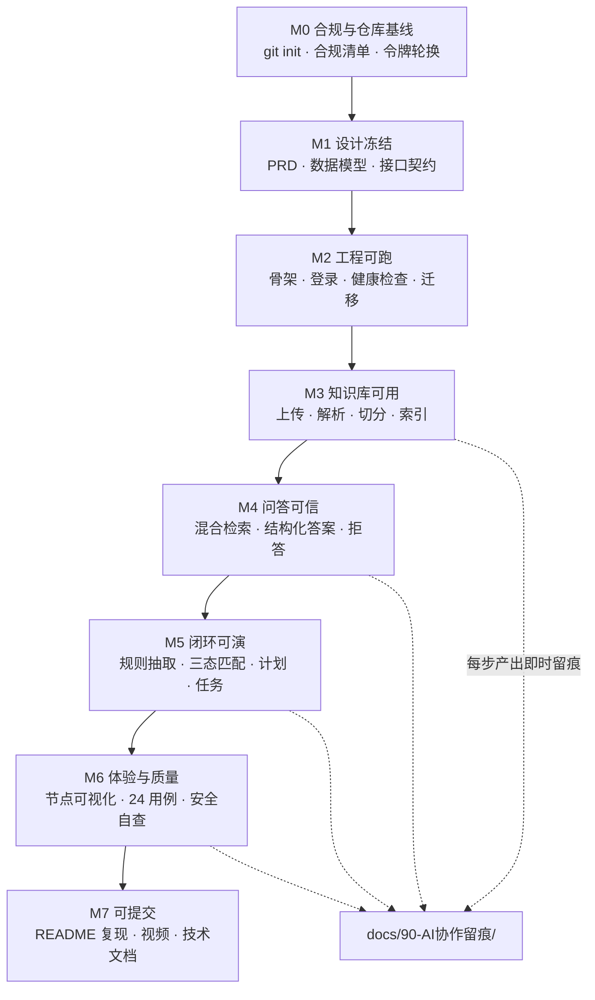
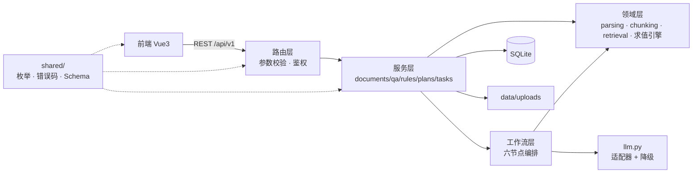

# 项目实施基本流程与启动检查报告

> 项目：知校 · 校园政策智能理解与事务规划系统
> 文档版本：V1.0
> 编制日期：2026-11-07
> 依据材料：`01-项目介绍文档.md`、`02-项目实施整体框架步骤文档.md`、`03-WorkBuddy分阶段完整提示词文档.md`、`docs/20-系统设计/系统设计说明书.md`，以及既有项目 `D:\私人\学习\大三上\物联网应用软件开发`（智能教室设备管控系统）的工程实践。
> 本文性质：**流程基线 + 启动检查报告**。不含代码，不修改任何现有实现。

---

## 修订记录

| 版本 | 日期 | 修订内容 |
| --- | --- | --- |
| V1.0 | 2026-11-07 | 首版：固化工程惯例、压缩为 7 个里程碑 + 11 天排期、回答总控提示词五问、列待拍板事项与风险 |
| **V1.1** | 2026-11-07 | 决策落地：D-1/D-2 经确认采用 **Flask 3 + Vue3**；仓库已改名 `campus-policy-planner`；新令牌已入 `.env`；接口数口径由 29 更正为 **30**；新增 §7 落实记录（M0/M1 产出清单） |

---

## 0. 摘要：一屏看完

| 问题 | 结论 |
| --- | --- |
| **工期还剩多少** | **11 天**（2026-11-07 → 11-18 提交截止）。`03` 文档的 13 阶段按原样执行不可能完成，必须压缩为 7 个里程碑，且 P1 功能全部可砍。 |
| **当前工程状态** | 只有 5 份 Markdown（3 份规划 + README + 设计说明书）；**无 Git 仓库**；**无任何代码、无依赖清单、无环境模板**。技术栈"已设计未落地"。 |
| **远程仓库** | ~~`liqing-258/-`~~ → 已改名为 **`liqing-258/campus-policy-planner`**，公开、默认分支 `main`、体积 0 KB、根目录仅一个 3 字节的 `README.md`。等价于空库，可直接作为 `origin`。 |
| **最大风险** | 不是技术，是**工期**与**Git 历史空白**。赛事明文禁止"一次性 initial commit"，历史必须从现在开始积累，而不是等代码写完再建仓库。 |
| **今天必须做的第一件事** | `git init` + 提交现有文档。这一步不写任何代码，但不做，11/18 就无法交出合格的历史。 |
| **待你拍板** | ~~后端、前端、模型供应商三项~~ → **已确认 Flask 3 + Vue3**（D-1/D-2）。仅剩 **D-3 模型接入信息未提供**（不影响 M2/M3，M4 前必须补）。 |

---

## 1. 从既有项目继承的工程惯例

### 1.1 我实际核对了什么

不是"参考了一下"，而是逐目录核对：

| 核对对象 | 实际情况 |
| --- | --- |
| 顶层结构 | `app/`（Flask 应用，扁平按域一文件）、`shared/`（纯标准库跨进程共享层）、`frontend/`（Vue3+Vite）、`desktop/`（tkinter 交付端）、`data/`、`deploy/`、`scripts/`、`tools/`、`docs/` |
| 文档体系 | `docs/` 下按主题分 13 个子目录：需求分析、系统设计、接口契约、接口设计、设备管理、时序数据、数据服务、告警引擎、接入服务、前端、原型设计、联调、部署、交付说明、实验日志 |
| 文档形态 | **每份文档 md + 同名 docx 成对**；命名 `系统名_主题_vX.Y.md`；`系统设计说明书` 已迭代到 v0.6 |
| 接口契约 | `docs/接口契约/接口契约统一规范_v1.0.md` + `字段观测表_v1.0.md`（1273 个字段、171 次真实请求的原始响应留档） |
| 工具链 | `tools/md_to_docx.py`（md→docx 单一出口）、`tools/frontend_docs_build/` 下 `dump_routes.py` / `verify_contract.py` / `verify_docx.py` / `neg_verify.py`、`tools/run_checks.bat` |
| 启动脚本 | `scripts/start.bat` / `start.sh` / `start_access.*` / `start_agg.*`（每个进程一对） |
| README | 十章：四层架构 / 快速开始 / 项目结构 / 功能与需求对照 / 角色与权限 / 验证方式（分 6 档）/ 接入真实基础设施 / 答辩演示流程 / 已知简化与边界 / 文档索引 |

### 1.2 九条可复用的硬惯例

这九条是旧项目真正跑通过的，本项目直接照搬，不重新发明：

| # | 惯例 | 旧项目的证据 | 本项目落地方式 |
| --- | --- | --- | --- |
| C-01 | **文档先行，一主题一份，带修订记录与版本号** | `系统设计说明书` v0.1→v0.6；需求报告带"修订记录"章 | 每份文档首章为修订记录；版本只在 0.x 内迭代，冻结后升 1.0 |
| C-02 | **md 是源，docx 是派生物** | 同主题只留一份 md + 同名 docx，由 `tools/md_to_docx.py` 生成 | 一律 md 写、脚本转 docx；禁止在 Word 里手改正文 |
| C-03 | **契约先行 + 字段观测表** | 1273 个字段来自 171 次真实请求，不靠想象填表 | 先用真实响应生成字段表，再据此写前端与校验 |
| C-04 | **数字一律实算** | 接口数以 `app.url_map` 为准（125 条），`dump_routes.py` 两趟探针导出 | 接口数、用例数、覆盖率、页数全部由脚本产出，禁手填 |
| C-05 | **每份关键文档配构建脚本 + 校验脚本** | `frontend_docs_build/` 一个 doc 配一个 `verify_*.py` + `neg_verify.py`（反向断言） | 文档产出后跑"应出现/不应出现"双向断言 |
| C-06 | **统一响应外壳与分段错误码** | `{code,message,data,request_id,timestamp}`；1xxx 参数 / 2xxx 资源 / 3xxx 权限 / 9xxx 系统 | 沿用同一外壳，改编为 AI 场景码段（见 §3.2） |
| C-07 | **每进程一对启动脚本** | `start_access.bat/.sh`、`start_agg.bat/.sh` | `start-backend` / `start-frontend` 各一对 |
| C-08 | **README 有"验证方式"分档 + "已知简化与边界"** | 第六章 6 档验证、第九章边界 | 直接沿用这两章骨架 |
| C-09 | **已知问题显式登记，不装** | 记忆中记录"未做事项显式顺延 §12.3" | `docs/known-limitations.md` 常驻，演示时不遮掩 |

### 1.3 旧项目踩过的坑，本项目提前规避

| 坑 | 旧项目实际后果 | 本项目对策 |
| --- | --- | --- |
| 对工作区执行 `git stash` | `.git` 整目录进回收站，需按原路径还原 | **禁用 `git stash`**；改动用"复制 → 改 → 复制回"，或先 `git commit` 再改 |
| 手填契约数字 | 写了不存在的页面名，校验只比两档，静默通过 | 数字全部脚本导出 + 双向断言扫描 |
| 文档生成器 `DOC` 路径指向旧版本 | 新内容写进了历史基线 v0.3 | 生成器路径只指向最新版；升版前先改路径 |
| 推送把令牌拼进远程 URL | 令牌留在 `.git/config` 与 shell 历史 | 本次用 PAT 走 `credential` 临时注入，**不写入 config**；且见 §3.5 令牌轮换 |
| 宽表里多个键塞进一个反引号 | docx 列宽被撑爆 | 每键一对反引号、空格分隔 |

### 1.4 本项目必须**新增**的四个环节

旧项目是确定性系统（MQTT 报文、SQL 查询、状态机），本项目引入大模型，不确定性进入工程链路，因此旧流程不够用，必须加四道闸：

| 新增 | 为什么旧流程覆盖不了 | 放在哪个阶段 |
| --- | --- | --- |
| **N-01 AI 输出契约校验闸** | 模型返回非 JSON、引用编造 chunk_id 是常态，不是异常 | M4（问答）、M5（规则） |
| **N-02 评测集（24 条 × 6 类）** | 确定性系统用单测就够，AI 需要"质量基准"才能判断改 Prompt 是变好还是变坏 | M4 起建立，M6 全量跑 |
| **N-03 Prompt 留痕（≥3 份完整链）** | 赛事硬性要求，且是 25% 评分项 | 贯穿 M3–M6，随做随记 |
| **N-04 提示注入与隐私红线自查** | 旧项目不处理"文档正文里的恶意指令" | M6 安全检查 |

---

## 2. 本项目的实施基本流程

### 2.1 工作单元：一个功能 = 三件套

旧项目最值得继承的不是目录，而是**工作单元的粒度**。本项目每个可交付功能都按同一节奏推进：

```
① 写契约（schema / 字段表 / 错误码）  →  ② 写实现（服务 + 路由）  →  ③ 写自检（脚本或 pytest）
        ↓                                        ↓                          ↓
   人工确认后才动代码                      小批次提交一次            通过才进下一个功能
```

**禁止**：先批量生成全部代码，再回头补文档与测试。理由不是教条，而是：11 天里如果第 7 天才发现契约设计错了，没有时间返工。

### 2.2 主流程



### 2.3 七个里程碑与门禁

| 里程碑 | 目标 | 文档产物 | 代码产物 | 门禁（不过不进下一阶段） | 预计提交数 |
| --- | --- | --- | --- | --- | --- |
| **M0**<br/>11-08 上午 | 仓库与合规基线 | 合规清单、提交清单、风险登记 | 无（仅 `.gitignore`/`.env.example`） | 远程可推；5 份文档已入库；令牌已轮换 | 2–3 |
| **M1**<br/>11-08 | 设计冻结 | PRD、data-model、api-contract、用户旅程 | 无 | 三项技术选择已确认；接口清单含错误码；字段表可对照 | 2–4 |
| **M2**<br/>11-09 | 工程可跑 | 运行说明草稿 | 前后端骨架、登录、`/health`、建表脚本 | 新环境按 README 能起；`/health` 200；无密钥入库 | 4–6 |
| **M3**<br/>11-10 | 知识库可用 | 文档入库模块设计 | 上传、解析、切分、索引 | T-01–T-07 通过；扫描件有明确提示 | 4–6 |
| **M4**<br/>11-11 | 问答可信 | 检索与问答设计、Prompt 留痕① | 混合检索、结构化答案、引用校验、拒答 | 24 条评测集 B 类拒答 ≥ 90%；引用越界 = 0 | 5–7 |
| **M5**<br/>11-12～13 | 闭环可演 | 规则与计划设计、Prompt 留痕②③ | 规则抽取、三态匹配、计划草稿、确认、任务 | T-13–T-22 通过；未确认草稿不入库 | 8–10 |
| **M6**<br/>11-14～16 | 体验与质量 | 测试报告、安全自查、已知限制 | 前端全页面、节点轨迹、三态渲染 | P0 门禁 8 项全过；T-01–T-24 有执行记录 | 8–12 |
| **M7**<br/>11-17～18 | 可提交 | README 终版、技术文档 ≤30 页、视频脚本 | 修复收尾 | 陌生环境 10 分钟复现成功；视频含 2 分钟 AI 协作 | 4–6 |

**总计约 37–54 次提交**。这个数量级才能满足"细粒度、每次对应一次 AI 对话"的赛事要求。

### 2.4 11 天排期（按天，可直接执行）

| 日期 | 星期 | 主任务 | 当日必须产出的证据 |
| --- | --- | --- | --- |
| 11-08 | 日 | M0 + M1：建仓库、推文档、冻结设计与三项技术选择 | `git log` 有 4–6 条提交；合规清单可用 |
| 11-09 | 一 | M2：骨架、登录、`/health`、建表 | 截图：`/health` 返回；README 启动段可用 |
| 11-10 | 二 | M3：上传、解析、切分、索引 | 3 份测试文档解析结果（正常 PDF / DOCX / 空文本） |
| 11-11 | 三 | M4：混合检索 + 结构化问答 + 拒答 | 评测集首轮结果表（含失败案例） |
| 11-12 | 四 | M5 上半：规则抽取 + 三态匹配 | 五类匹配场景截图（全符合/不符/缺信息/歧义/无证据） |
| 11-13 | 五 | M5 下半：计划草稿 + 确认 + 任务中心 | 一条完整链路录屏（问答→匹配→计划→任务完成） |
| 11-14 | 六 | 前端全页面 + 主链路串通 | 7 个页面截图，无死按钮 |
| 11-15 | 日 | 体验打磨：引用弹层、节点轨迹、三态、空/错态 | 引用点击回原文的录屏 |
| 11-16 | 一 | 测试 + 修 bug + 安全自查 | `pytest` 输出、T-01–T-24 执行表 |
| 11-17 | 二 | README 复现（干净目录实测）+ 技术文档压缩 | 10 分钟计时记录；≤30 页 PDF |
| 11-18 | 三 | 录视频（5–8 分钟，含 2 分钟 AI 协作）+ 提交材料核对 | 视频文件、提交清单逐项打勾 |

> **缓冲策略**：M5 结束（11-13）是硬分界。若此时主链路未通，立即砍掉 M6 前端可视化（P1），只保留"能演示"的最小页面，把 11-14～16 全部投入修链路。**宁可少一个页面，不能断一条链路。**

### 2.5 文档体系规划

沿用旧项目的"按主题分目录 + 编号前缀定构建顺序"，编号即阅读顺序：

```text
docs/
├── 00-合规与提交/
│   ├── 比赛合规清单.md
│   └── 提交材料核对表.md
├── 10-需求分析/
│   ├── PRD.md
│   ├── 用户故事与验收标准.md
│   └── 用户旅程.md
├── 20-系统设计/
│   ├── 系统设计说明书.md          ← 已有 V1.0，M1 升 V1.1
│   ├── 数据模型.md
│   └── 架构图.md
├── 30-接口契约/
│   ├── 接口契约统一规范.md
│   ├── 接口清单.md                ← 由脚本从路由导出，禁手填
│   └── 字段观测表.md              ← 由真实响应生成
├── 40-模块设计/
│   ├── 文档入库与解析.md
│   ├── 检索与问答.md
│   ├── 规则抽取与三态匹配.md
│   └── 计划与任务.md
├── 50-测试与评测/
│   ├── 测试报告.md
│   ├── 评测集与结果.md
│   └── 安全自查.md
├── 60-交付/
│   ├── 运行与验证说明.md
│   └── 已知限制.md
└── 90-AI协作留痕/
    ├── 01-需求与架构.md
    ├── 02-文档入库.md
    ├── 03-检索问答.md             ← 必做
    ├── 04-规则匹配.md             ← 必做
    ├── 05-计划生成.md             ← 必做
    └── 06-Bug修复.md
```

**版本策略**（继承旧项目）：

1. 未冻结期用 `v0.x`，冻结后升 `v1.0`；
2. 升版时**只改生成器指向的最新文件**，历史基线保留不动；
3. 同主题只保留一份 md + 同名 docx，不出现 `_最终版`、`_改`、`_new`；
4. 数字变更必须同步更新所有引用处，靠"反向断言脚本"兜住（旧项目吃过这个亏）。

### 2.6 Git 提交节奏示例

M3（文档入库）阶段的真实提交应按此粒度：

```text
chore: init repo with planning docs and gitignore
docs: add competition compliance checklist
feat(core): add app factory, config loader and unified response envelope
feat(core): add health check endpoint
feat(db): add core models and create-tables script
feat(auth): add jwt login with demo student and admin
feat(doc): add upload endpoint with whitelist and size limit
feat(parse): extract pdf text with page metadata
feat(parse): handle encrypted and scanned pdf with explicit errors
feat(chunk): structure-aware splitter with configurable overlap
feat(index): build bm25 index and persist embeddings
fix(parse): skip empty pages instead of failing whole document
test: cover upload reject cases and empty text handling
```

**每条提交对应一次与 AI 的真实交互**，提交说明写"做了什么"，Prompt 留痕写"怎么让它做出来的"，两者通过 commit 哈希关联。

---

## 3. 总控提示词五问的答复

### 3.1 当前目录结构与已有技术栈

**实际盘点结果（非推测）**：

| 项 | 状态 |
| --- | --- |
| 根目录文件 | `01-项目介绍文档.md`、`02-项目实施整体框架步骤文档.md`、`03-WorkBuddy分阶段完整提示词文档.md`、`README.md`、`docs/20-系统设计/系统设计说明书.md` |
| Git | **未初始化**（`fatal: not a git repository`） |
| 代码 | **零**。无 `app/`、无 `requirements.txt`、无 `package.json`、无 `.env.example`、无 `.gitignore` |
| 技术栈 | **仅存在于文档中**（设计说明书按 FastAPI + React + SQLite 描述），未落地任何依赖 |
| 运行时 | Python 3.13.12（managed）/ 3.14.3（`E:\phython`，唯一带 tkinter）；Node 22.22.2 / 24.21.0 |
| 远程仓库 | `liqing-258/-`：公开、`main`、0 KB、根目录仅 3 字节 `README.md` |

**结论**：这是一张白纸，**此刻锁定技术栈的代价为零**；一旦写完第一个模块，切换代价跳到 3–5 天。这是叫停"直接开写"的唯一理由。

**另外两个事实性提醒**：

1. 远程仓库名是 `liqing-258/-`，仓库名就是一个连字符。推送、评审访问、README 徽章都会显得异常，且容易在命令里被 shell 误解析。建议改为 `campus-policy-planner`（GitHub 支持随时改名，旧链接自动重定向）。
2. 该仓库目前是**公开**的，符合赛事"Public 或提供评审访问权限"的要求，这点不用改。

### 3.2 建议的最终架构

**架构风格**：模块化单体 + 六节点顺序工作流。不做微服务，不引 Agent 框架（理由见设计说明书 3.2）。

**目录级架构**（刻意贴近你旧项目的肌肉记忆：`app/` 扁平按域、`shared/` 纯共享层、`scripts/` 成对启动、`tools/` 构建校验）：

```text
campus-policy-planner/
├── app/                        # Flask 应用
│   ├── __init__.py             # create_app
│   ├── config.py               # 配置集中读取
│   ├── contract.py             # 统一响应外壳（唯一实现）
│   ├── errors.py               # 错误码与异常体系
│   ├── auth.py                 # JWT、角色守卫
│   ├── documents.py            # 上传 / 列表 / 删除
│   ├── parsing.py              # PDF / DOCX / TXT 解析
│   ├── chunking.py             # 结构化切分
│   ├── retrieval.py            # BM25 + 向量 + RRF
│   ├── qa.py                   # 结构化问答 + 引用校验
│   ├── rules.py                # 规则抽取 + 三态求值
│   ├── plans.py                # 计划草稿 / 确认
│   ├── tasks.py                # 任务 CRUD 与状态机
│   ├── workflows.py            # 六节点编排 + run 轨迹
│   ├── models.py               # SQLAlchemy 模型
│   ├── schemas.py              # pydantic v2 契约
│   └── llm.py                  # 模型适配器（可降级）
├── shared/                     # 纯标准库，前后端共用
│   ├── enums.py                # 状态枚举、算子枚举
│   ├── codes.py                # 错误码常量
│   └── schema/                 # JSON Schema 文件（答案、规则）
├── frontend/                   # Vue3 + Vite
│   ├── src/{views,components,api,stores}
│   └── package.json
├── data/                       # app.db + uploads/（不入库）
├── demo/                       # 虚构演示文档（入库）
├── docs/                       # 见 §2.5
├── tools/                      # 契约导出、文档转换、自检
├── scripts/                    # start-backend / start-frontend 各 .bat + .sh
├── .env.example
├── .gitignore
└── README.md
```

**分层与调用约束**（与旧项目一致的"应用层不碰底层"原则）：



三条硬约束：

1. `shared/` **只允许标准库**，不得 import `app`（沿用旧项目 `shared/` 规则）；
2. 路由层不写业务逻辑，只做参数校验 + 调用服务 + 外壳封装；
3. 只有 `llm.py` 允许出网，其它模块不得直接调用模型 API。

**错误码分段**（在旧项目 `1xxx/2xxx/3xxx/9xxx` 体系上扩一夜 AI 段）：

| 段 | 含义 |
| --- | --- |
| 0 | 成功 |
| 1xxx | 参数 / 校验 |
| 2xxx | 资源（含 2001 重复上传、2005 状态冲突） |
| 3xxx | 权限 |
| **4xxx** | **AI 链路（4001 证据不足、4002 输出结构非法、4003 引用越界、4004 模型超时、4005 降级中）** |
| 9xxx | 系统 |

### 3.3 关键技术选择（V1.1 已确认）

**确认结论**：D-1 采用 **Flask 3**、D-2 采用 **Vue3 + Vite**，其余按推荐执行。D-3（模型接入）仍缺实际信息，是唯一未决项。

| # | 决策 | 结论 | 状态 | 差异与理由 |
| --- | --- | --- | --- | --- |
| **D-1** | 后端框架 | **Flask 3**（`app/` 扁平按域 + Blueprint，pydantic v2 做校验层） | ✅ 已确认 | 你已用 Flask 做过 125 接口、JWT、契约外壳；换 FastAPI 需重建约 1.5 天，工期只有 11 天。校验能力用 pydantic v2 单独接入即可补上，不必换框架 |
| **D-2** | 前端框架 | **Vue3 + Vite + TypeScript** | ✅ 已确认 | 既有项目 `frontend/` 即 Vue3+Vite；换 React 需重学状态与组件习惯，7 个页面省不下时间 |
| **D-3** | 模型供应商 | OpenAI 兼容协议；base_url / model / key 待填 | 🟡 **唯一未决** | 无 Key 时 M4 的"生成"环节走降级（检索直出），链路不阻塞但问答质量受损。请在 11-10 前给出 base_url + model |
| D-4 | 数据库 | SQLite | ✅ 已确认 | 10 分钟复现是硬指标；12 张表、< 2 万片段，SQLite 足够；SQLAlchemy 写，随时可切 |
| D-5 | 检索实现 | 自研 BM25 + 向量 + RRF | ✅ 已确认 | 省掉 Docker 与向量库；检索层接口化，后期可换 |
| D-6 | 鉴权 | JWT + 2 个演示账号 | ✅ 已确认 | 无鉴权则无法演示"用户数据隔离"与越权拦截，会丢工程质量分 |
| D-7 | 演示主场景 | 奖学金申请 | ✅ 已确认 | 条件维度最全（学籍/成绩/排名/处分/困难认定），最适合展示三态匹配 |
| D-8 | ECharts 统计页 | 做，但排在 M6 且可砍 | ✅ 已确认 | 有经验、成本低；但属 P1，链路不通时第一个砍 |
| D-9 | 仓库改名 | 已改为 `campus-policy-planner` | ✅ 已完成 | 原仓库名为单个 `-`，命令可读性与观感都差 |

> **技术栈定版的连带修订**：`docs/20-系统设计/系统设计说明书.md` 已升 **V1.1**，第 3/6/8/10/12/13 章与里程碑表全部按 Flask + Vue3 改写；原 FastAPI + React 方案作废，不再作为备选保留。


### 3.4 第一阶段的具体计划（M0 + M1，11-08 一天内完成）

**范围声明**：本阶段**不写任何业务代码**，只做仓库基线、合规清单与设计冻结。这是唯一允许"先文档后代码"的阶段。

#### 任务清单

| ID | 任务 | 产出 | 预计 | 状态 |
| --- | --- | --- | --- | --- |
| T-01 | 撤销并重建 GitHub PAT | 新令牌已放入本地 `.env`（不入库） | 5 min | ✅ 完成 |
| T-02 | 仓库改名为 `campus-policy-planner` | `https://github.com/liqing-258/campus-policy-planner.git` | 3 min | ✅ 完成 |
| T-03 | `git init` + `.gitignore` + `.env.example` | 仓库可提交 | 15 min | ✅ 文件已就绪 |
| T-04 | 首次提交：既有规划文档 + M1 文档 | `commit#1..#n` | 10 min | ⬜ 待执行 |
| T-05 | 绑定 `origin` 并推送 `main` | 远程可见 | 10 min | ⬜ 待执行 |
| T-06 | `docs/00-合规与提交/比赛合规清单.md` | 规则提取 + 提交核对表 + 倒排期 | 40 min | ✅ 完成 |
| T-07 | `docs/10-需求分析/PRD.md` | P0 十项 + 8 条用户故事 + 可判定验收标准 | 90 min | ✅ 完成 |
| T-08 | `docs/20-系统设计/数据模型.md` | 12 张表 + 枚举 + 状态机 + SQLite 约定 | 90 min | ✅ 完成 |
| T-09 | `docs/30-接口契约/接口契约统一规范.md` | 外壳、错误码（含 4xxx）、分页、幂等 | 60 min | ✅ 完成 |
| T-10 | `docs/30-接口契约/接口清单.md` | **30** 条路由 × 角色 × 入参出参 | 90 min | ✅ 完成 |
| T-11 | `docs/90-AI协作留痕/` 模板 + 首份记录 | 模板 + `01-需求与架构.md`（3 条目） | 20 min | ✅ 完成 |
| T-12 | 设计说明书升 V1.1 | 技术栈、ADR、里程碑对齐 | 40 min | ✅ 完成 |
| T-13 | M1 门禁自检 + 提交推送 | `commit#...` | 20 min | 🟡 门禁待逐项打勾 |

> **口径更正**：V1.0 中 T-10 写的"29 条路由"为口算结果，逐行统计后实为 **30 条**（GET 14 / POST 12 / PATCH 3 / DELETE 1）。按"数字一律实算"原则已在接口清单中注明该数需在代码落地后用 `app.url_map` 复核。


合计约 **8 小时**，一天可完成。若当天只能做 4 小时，**优先级：T-01 → T-03/04/05 → T-06 → T-07**，其余顺延到 11-09 上午。

#### M1 门禁（逐项可判定）

- [ ] `git log --oneline` 至少 4 条提交，无"all in one"式提交；
- [ ] 远程 `main` 可见，README 在网页端能正常渲染；
- [ ] 仓库内 `git grep` 不到任何令牌、密码、真实个人信息；
- [ ] PRD 中每条 P0 功能都有"可判定"的验收标准（不是"体验良好"这类）；
- [ ] 接口清单条数由脚本或人工逐条核对，且与设计说明书第 6 章一致；
- [ ] 数据模型 12 张表每张都有主键、至少一个索引、枚举取值；
- [ ] 设计说明书 V1.1 与 D-1/D-2 的结论一致（同一份仓库里不允许两套技术栈描述）。

#### 本阶段禁止事项

1. 不创建 `app/`、`frontend/` 目录（留给 M2）；
2. 不安装任何依赖（避免"装了一半开始写"，导致环境不可复现）；
3. 不写 Dockerfile（M7 视情况再说）；
4. 不把令牌写进 `.env`、文档或提交说明。

### 3.5 风险清单

| ID | 风险 | 概率 | 影响 | 应对 | 触发信号 |
| --- | --- | --- | --- | --- | --- |
| R-01 | **11 天工期不足以走完 13 阶段** | 高 | 致命 | 压缩为 7 里程碑；P1 全部可砍；11-13 为硬分界 | 11-13 主链路未通 |
| R-02 | **Git 历史起步太晚**，最终仅几条大提交 | 中 | 致命（25% 评分） | 今天 `git init`；每功能必提交 | `git log` 单条 diff > 800 行 |
| R-03 | **没有可用模型 Key**，M4 起阻塞 | 中 | 高 | 立刻确认 D-3；降级模式保证链路可跑 | 11-11 仍无 Key |
| R-04 | 技术栈切换（Flask↔FastAPI） | 中 | 高 | M1 前拍板，之后冻结 | M2 之后仍有"要不要换框架"的讨论 |
| R-05 | 令牌已泄露在对话中 | **已发生** | 高 | **立即撤销重建**；本次仅做过 3 次只读 GET（user / repos / contents），未写入任何文件或远程 URL | — |
| R-06 | AI 输出不稳定导致演示翻车 | 高 | 中 | 引用白名单 + Schema 校验 + 拒答；演示用固定文档 + 低 temperature | 同一问题两次答案差异过大 |
| R-07 | 中文 PDF 多栏/表格解析错乱 | 高 | 中 | 接受不完美，界面提示"表格请核对原文"；不做 OCR | 解析后文本顺序明显错乱 |
| R-08 | 规则抽取把"主观条款"抽出成硬条件 | 中 | 高 | `manual_review` 兜底 + 原文子串校验 | 出现"表现突出 ≥ 3 次"这类伪规则 |
| R-09 | 12 张表设计过度，实现拖慢 | 中 | 中 | 可先建 8 张核心表，其余留迁移 | 11-09 建表仍未完成 |
| R-10 | 重蹈 `git stash` 事故 | 低 | 高 | 禁用 stash；改动前先提交 | 有人想"临时收起改动" |
| R-11 | 数字手填导致文档与代码不一致 | 中 | 中 | 接口数/用例数由脚本导出 + 双向断言 | 文档写 29 条、代码 31 条 |
| R-12 | 评审电脑无 Python/Node | 低 | 高 | README 写死版本要求 + 提供镜像源 + 启动自检脚本 | 实测环境与开发环境版本差 |
| R-13 | 隐私红线（真实学号/成绩） | 低 | 高 | 演示数据全虚构，标题带"（演示样例）" | 样例里出现真实院校名或学号格式 |

---

## 4. 立即要做的事（V1.1 更新）

已完成：令牌已轮换并放入本地 `.env`；仓库已改名；M1 文档已产出。

剩余三件，按顺序：

1. **`git init` 并推送**：这是唯一还没做的 M0 动作。不写代码，但不做，11/18 交不出合格历史。
2. **补 D-3 模型接入信息**：base_url + model（Key 只进 `.env`）。11-10 前给到即可，不影响 M2/M3。
3. **逐项核对 M1 门禁**（见 §3.4 末），通过后我才开 M2 写代码。

---

## 5. 待确认清单（V1.1 状态）

| # | 事项 | 结论 | 状态 |
| --- | --- | --- | --- |
| 1 | 后端框架（D-1） | **Flask 3** | ✅ 已确认 |
| 2 | 前端框架（D-2） | **Vue3 + Vite** | ✅ 已确认 |
| 3 | 模型接入（D-3） | OpenAI 兼容协议已定；base_url / model 待填 | 🟡 **待你提供** |
| 4 | 仓库改名（D-9） | `campus-policy-planner` | ✅ 已完成 |
| 5 | 里程碑压缩（13 阶段 → 7 里程碑） | 接受 | ✅ 已确认 |
| 6 | 11-13 硬分界（链路不通则砍前端可视化） | 接受 | ✅ 已确认 |
| 7 | 数据库（D-4） | SQLite | ✅ 已确认 |
| 8 | 演示主场景（D-7） | 奖学金申请 | ✅ 已确认 |
| 9 | 参赛组别 | 待报名时核定（普通本科 → B 组） | ⬜ 需你核对 |

---

## 6. 附：旧项目 → 本项目的映射总表

| 旧项目构件 | 本项目对应 | 是否照搬 |
| --- | --- | --- |
| `app/` 扁平按域一文件 | `app/*.py` 同构 | 照搬 |
| `shared/` 纯标准库共享层 | 枚举 / 错误码 / JSON Schema | 照搬（且前后端共用） |
| `app/contract.py` 统一外壳 | `app/contract.py` | 照搬，错误码加 4xxx |
| `docs/` 按主题分目录 + 版本号 | `docs/00~90` 编号目录 | 照搬，加 `90-AI协作留痕` |
| `tools/md_to_docx.py` | 同名 | 照搬 |
| `verify_*.py` / `neg_verify.py` | 文档双向断言 | 照搬（技术文档 ≤30 页时必用） |
| `scripts/start_*.bat/.sh` | `start-backend` / `start-frontend` | 照搬 |
| `tools/run_checks.bat` | `tools/run_checks.bat`（测试 + 契约校验） | 照搬 |
| 设备模拟器 `simulator/` | **无对应物** | 不需要 |
| InfluxDB / MQTT / 物模型 | **无对应物** | 不需要 |
| `desktop/` tkinter 交付端 | **不采用**，本项目交付 Web | 明确不做 |
| 四层物联网架构 | 改为"表现/接口/服务/领域/基础设施"五层 | 重构 |

---

## 7. V1.1 落实记录（M0 / M1 产出清单）

### 7.1 仓库与基线

| 项 | 结果 |
| --- | --- |
| 仓库 | `https://github.com/liqing-258/campus-policy-planner`（Public，`main`） |
| 凭据 | 新 PAT 已存本地 `.env`，`.env` 已入 `.gitignore`，未写入任何文档或远程 URL |
| 忽略规则 | `.gitignore` 覆盖 venv / node_modules / `.env` / `data/*.db` / uploads / `.workbuddy` |
| 环境模板 | `.env.example` 全部占位值，含模型与检索参数 |

### 7.2 文档产出

| 文档 | 版本 | 行数级 | 作用 |
| --- | --- | --- | --- |
| `docs/00-合规与提交/比赛合规清单.md` | V1.0 | ~150 | 规则提取、6 项提交材料、7 条红线、11 天倒排、提交前核对表 |
| `docs/10-需求分析/PRD.md` | V1.0 | ~180 | P0 十项 / P1 六项 / P2 八项不做；8 条用户故事全部可判定 |
| `docs/20-系统设计/系统设计说明书.md` | **V1.1** | ~1580 | 技术栈定版、12 张表、30 条接口、四层意图控制、24 用例、M0–M7 |
| `docs/20-系统设计/数据模型.md` | V1.0 | ~270 | 12 张表字段、枚举、状态机、SQLite 落地约定、规模估算 |
| `docs/30-接口契约/接口契约统一规范.md` | V1.0 | ~200 | 外壳、错误码（0/1xxx/2xxx/3xxx/**4xxx**/9xxx）、分页、幂等、鉴权 |
| `docs/30-接口契约/接口清单.md` | V1.0 | ~200 | **30** 条接口 × 角色 × 里程碑 × 错误码；关键接口入参出参 |
| `docs/90-AI协作留痕/_模板.md` | V1.0 | ~60 | 8 段式留痕模板 + 写作纪律（禁事后补写） |
| `docs/90-AI协作留痕/01-需求与架构.md` | V1.0 | ~180 | 本日 3 条真实 Prompt 记录（含被否决方案与返工） |
| `README.md` | **V1.1** | ~540 | 技术栈定版、快速开始、环境变量、FAQ、已知限制 |
| `04-项目实施基本流程与启动检查报告.md` | **V1.1** | ~460 | 本文：惯例、流程、排期、五问、决议 |

### 7.3 一致性校正

| 问题 | 处理 |
| --- | --- |
| 说明书 V1.0（FastAPI/React）与决议冲突 | 升 V1.1 全量改写，声明原方案作废，不留备选 |
| 接口数口算 29 → 实为 30 | 已在接口清单注明计数口径，并要求代码落地后用 `app.url_map` 复核 |
| 设计说明书路径 | 迁入 `docs/20-系统设计/`，README 与本文引用同步 |
| 令牌残留 | 全文检索无 `ghp_` 命中 |

### 7.4 仍未闭环（明确列出，不含糊）

| # | 未闭环项 | 影响 | 何时必须解决 |
| --- | --- | --- | --- |
| 1 | `git init` 与首次推送未执行 | 无 Git 历史 = 25% 评分项为零 | **今天** |
| 2 | D-3 模型 base_url / model 未提供 | M4 起问答只能走降级生成 | 11-10 前 |
| 3 | 参赛组别未核对（B 组？） | 组别错选直接取消资格 | 报名时 |
| 4 | 演示用虚构政策文件尚未制作 | M3/M4 无素材可测 | 11-09 前 |
| 5 | 技术文档 ≤30 页提交版未压缩 | 现为素材库体量 | 11-17 |

---

**文档结束**

> 一句话总结：**流程照搬旧项目骨架，工期压到 11 天，多出的只有"AI 不确定性"的四道闸。文档已到 M1 门禁，剩下的是 `git init` 和一个模型 Key。**
