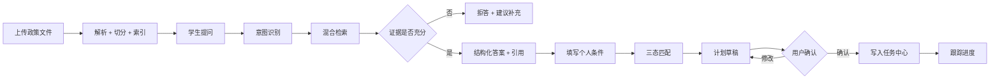
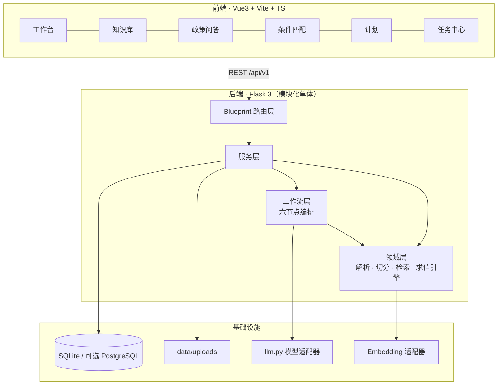

# 知校 · 校园政策智能理解与事务规划系统

> **Campus Policy Intelligence & Action Planner**
>
> 把分散的校园政策文件，转化为**有出处、可判断、可执行、可追踪**的个人事务方案。


---

## 0. 仓库状态（先读这一节）

| 项目 | 状态 |
| --- | --- |
| 合规清单 / 提交核对表 | ✅ 已完成（M0） |
| PRD、数据模型、接口契约与清单 | ✅ 已完成（M1） |
| 系统设计说明书 | ✅ V1.1 已定版（Flask 3 + Vue3） |
| 后端工程 `app/` | 📐 设计完成，M2 实现 |
| 前端工程 `frontend/` | 📐 设计完成，M2 实现 |
| 快速开始命令 | 📐 随 M2 起生效 |

> **诚实声明**：本仓库当前处于**设计冻结阶段（M1）**，尚未提交可运行代码。下方"快速开始"描述 M2 完成后的目标运行方式，命令在代码落地前执行会失败。
>
> 本表随里程碑更新。**参赛提交前若与实际情况不符，必须如实修改**——赛事明确禁止把未实现功能表述为已完成。

**工期**：2026-11-18 提交截止。里程碑 M0–M7 见 `04-项目实施基本流程与启动检查报告.md` §2.3。

---

## 1. 项目简介

大学生办一件事（申请奖学金、评奖评优、考试报名、学籍异动、请假证明、实习手续），通常要穿过五道断裂：

| 环节 | 真实处境 | 结果 |
| --- | --- | --- |
| 找 | 政策散在官网、学院群、PDF、办事指南 | 找不到，或找到的是上学年的旧版 |
| 读 | 正式文件长、条款嵌套、例外多 | 读不完，关键门槛记不住 |
| 判 | 条款是通用表述，不确定是否适用于自己 | 不敢申，或申了才发现不符合 |
| 办 | 材料、顺序、截止时间分散多处 | 漏材料、跑空路、错过节点 |
| 跟 | 多步骤事项没有统一跟踪 | 中断后遗忘 |

**知校**要解决的不是"查政策"，而是把政策变成一份**自己能照着做、且每一步都能回头核对原文**的清单。

产品主线只有一条：

```
政策文件 → 证据检索 → 带引用解释 → 条件结构化 → 三态匹配 → 计划草稿 → 用户确认 → 任务跟踪
```

### 与"校园 AI 聊天机器人"的区别

| 维度 | 普通政策问答 | 知校 |
| --- | --- | --- |
| 依据 | 模型自己的话 | 绑定 `文档 + 页码 + 章节 + 原文`，可点击回原文 |
| 判断 | 直接给"你能/不能" | 三态：符合 / 不符合 / **待补充或待核实**（并说明原因） |
| 输出 | 一段文字 | 结构化条件 + 任务清单 + 依赖关系 + 截止时间 |
| 信息不足 | 编一个答案 | 明确拒答，不产生任何具体数字与日期 |
| 版本 | 不感知 | 过期文件降权、冲突并列展示 |
| 判定权 | 模型 | 模型只抽取候选规则，**结论由代码计算** |

---

## 2. 核心能力

| 模块 | 能力 | 里程碑 |
| --- | --- | --- |
| 政策知识库 | PDF/DOCX/TXT/MD 上传、解析、结构化切分、元数据（部门/日期/学年/版本/状态） | M3 |
| 混合检索 | jieba 分词 BM25 + 向量余弦，RRF 融合，按有效状态过滤，冲突检测 | M4 |
| 政策问答 | 六段式结构化答案（结论/适用对象/要求/步骤/注意/来源），引用可点击 | M4 |
| 拒答机制 | 检索分低于阈值即说明"未找到足够依据"，并给可补充方向 | M4 |
| 规则抽取 | 从片段抽候选规则，`original_quote` 必须是原文子串（防伪造） | M5 |
| 三态匹配 | 8 种算子确定性求值；主观条款强制 `manual_review`，不下结论 | M5 |
| 事务计划 | 由规则生成任务草稿（材料/依赖/优先级），**用户确认后才落库** | M5 |
| 任务中心 | 列表/筛选/状态机流转/进度/来源溯源 | M5 |
| 工作流可视化 | 六节点（意图→检索→分析→匹配→规划→校验）状态、耗时、摘要 | M6（P1） |
| 降级模式 | 无模型 API Key 时主链路仍可完整演示，界面明确标注 | M2 |

### 主链路



---

## 3. 系统架构



**架构选型：模块化单体 + 自研六节点顺序编排器。**

不做微服务、不引入 Agent 框架的理由：单人开发、赛期仅 11 天，固定 6 节点顺序流程用约 60 行编排器即可覆盖，且每个节点的输入输出、耗时、失败原因全部可见——这在答辩时是可解释性优势，而不是技术落后。详见设计说明书 §3.2、ADR-01～09。

### 三条硬约束

1. `shared/` **只允许标准库**，不得 import `app`；
2. 路由层不写业务逻辑，只做参数校验 + 调用服务 + 外壳封装；
3. 只有 `app/llm.py` 允许出网调用模型。

---

## 4. 技术栈

**V1.1 定版：Flask 3 + Vue3**（理由：复用既有项目 125 接口 / JWT / 契约外壳的工程经验，工期仅 11 天）。原 FastAPI + React 方案已作废。

| 层次 | 选型 | 版本基线 | 用途 |
| --- | --- | --- | --- |
| 前端 | Vue 3 | ≥ 3.4 | SFC + `<script setup>` |
| 前端构建 | Vite | ≥ 5 | 端口 5173，`/api` 代理到 5000 |
| 前端语言 | TypeScript | ≥ 5.4 | 与后端共用 `shared/schema` 类型 |
| 前端状态 | Pinia | ≥ 2 | 仅存会话与筛选条件 |
| 图表 | ECharts | ≥ 5 | P1，M6 视工期 |
| 后端 | Flask | ≥ 3.0 | `create_app()` 工厂 + Blueprint 分域 |
| WSGI | waitress | ≥ 3.0 | 生产启动（Windows 友好） |
| 校验 | pydantic | ≥ 2.7 | 请求体、模型输出、规则 Schema |
| ORM | SQLAlchemy | ≥ 2.0 | 同一套模型切 SQLite / PostgreSQL |
| 数据库 | SQLite | 3.40+ | WAL 模式，`data/app.db` |
| 分词 | jieba | ≥ 0.42 | BM25 召回 |
| 数值 | numpy | ≥ 1.26 | 余弦相似度全量计算 |
| PDF 解析 | PyMuPDF | ≥ 1.24 | 保留页码 |
| DOCX 解析 | python-docx | ≥ 1.1 | 保留段落与标题 |
| 模型接入 | httpx（OpenAI 兼容） | ≥ 0.27 | 仅 `app/llm.py` 出网 |
| 测试 | pytest + pytest-cov | ≥ 8.0 | 单测 + 接口测试 |

> 未引入任何需要编译或额外服务的依赖（无 Docker、无向量库、无消息队列），以保证 10 分钟复现。

---

## 5. 环境要求

| 依赖 | 版本 | 检查命令 |
| --- | --- | --- |
| Python | 3.11 – 3.13 | `python --version` |
| Node.js | ≥ 18（推荐 20 LTS） | `node --version` |
| npm | ≥ 9 | `npm --version` |
| Git | ≥ 2.30 | `git --version` |

无需安装数据库，无需 Docker。模型 API Key 为**可选**。

---

## 6. 快速开始（目标 10 分钟）

> 以下步骤在 M2 完成后生效。

### 6.1 获取代码

```bash
git clone https://github.com/liqing-258/campus-policy-planner.git
cd campus-policy-planner
```

### 6.2 后端依赖

```bash
python -m venv .venv

# Windows
.venv\Scripts\activate
# macOS / Linux
source .venv/bin/activate

pip install -r requirements.txt

# 国内网络可加镜像
# pip install -r requirements.txt -i https://pypi.tuna.tsinghua.edu.cn/simple
```

### 6.3 配置环境变量

```bash
# Windows
copy .env.example .env
# macOS / Linux
cp .env.example .env
```

打开 `.env`，**至少填 `JWT_SECRET`**：`python -c "import secrets;print(secrets.token_hex(32))"`。需要 AI 生成能力再填 `LLM_BASE_URL` / `LLM_API_KEY` / `LLM_MODEL`。不填 Key 也可完成全部演示（降级模式）。

### 6.4 初始化数据库与演示数据

```bash
python tools/init_db.py
python tools/seed_demo.py
```

输出示例：

```
[ok] database initialized: data/app.db
[ok] demo users: student/student123, admin/admin123
[ok] demo documents: 3 (2 policy samples, 1 empty-text case)
[ok] llm mode: degraded (LLM_API_KEY not set)
```

### 6.5 启动

```bash
# 终端 1：后端
python run.py            # 开发模式，http://127.0.0.1:5000

# 终端 2：前端
cd frontend
npm install
npm run dev              # http://127.0.0.1:5173
```

或用一键脚本：`scripts/start-backend.bat` / `scripts/start-frontend.bat`（macOS/Linux 用同名 `.sh`）。

| 服务 | 地址 |
| --- | --- |
| 前端 | http://127.0.0.1:5173 |
| 健康检查 | http://127.0.0.1:5000/api/v1/health |
| 接口清单 | `docs/30-接口契约/接口清单.md` |

### 6.6 验证一条完整链路（约 3 分钟）

1. 用 `student / student123` 登录；
2. 进「政策知识库」，确认演示文档状态为 `indexed`；
3. 进「AI 政策问答」，提问：**"申请国家励志奖学金需要满足哪些条件，要交什么材料？"**；
4. 点击引用卡片，确认能打开对应原文片段；
5. 提一个知识库里没有的问题（如"转专业后已修学分如何认定"），确认系统**拒答而不编造**；
6. 进「条件匹配」，填写虚构条件，查看三态结果；
7. 生成计划草稿 → 编辑 → 确认 → 在任务中心完成一项任务。

---

## 7. 环境变量

完整模板见 `.env.example`。核心项：

| 变量 | 必填 | 缺省行为 |
| --- | --- | --- |
| `JWT_SECRET` | ✅ | 启动失败并提示生成方法 |
| `DATABASE_URL` | ❌ | `sqlite:///./data/app.db` |
| `LLM_BASE_URL` / `LLM_API_KEY` / `LLM_MODEL` | ❌ | 任一为空 → 降级模式，界面常驻提示 |
| `EMBEDDING_MODEL` | ❌ | 仅 BM25 检索 |
| `RAG_TOP_K` | ❌ | 6 |
| `RAG_MIN_SCORE` | ❌ | 0.35（拒答阈值） |
| `CHUNK_SIZE` / `CHUNK_OVERLAP` | ❌ | 600 / 80 |
| `MAX_UPLOAD_MB` | ❌ | 20 |
| `DEMO_BANNER` | ❌ | true（顶部显示"演示数据"标识） |

> **安全**：`.env` 已在 `.gitignore` 中；仓库只保留 `.env.example` 占位值。

---

## 8. 数据库与演示数据

```bash
# 建库（幂等，可重复执行）
python tools/init_db.py

# 导入虚构演示数据
python tools/seed_demo.py

# 重建（清空后重导，仅开发环境）
python tools/seed_demo.py --reset
```

**12 张表**：`users`、`documents`、`document_chunks`、`conversations`、`messages`、`policy_rules`、`match_sessions`、`match_result_items`、`action_plans`、`tasks`、`workflow_runs`、`qa_feedback`，另有 `audit_logs`。字段与索引见 `docs/20-系统设计/数据模型.md`。

| 演示文件 | 类型 | 用途 |
| --- | --- | --- |
| `demo/奖学金评审办法（演示样例）.pdf` | 10 页，含条件/材料/流程章节 | 主链路演示 |
| `demo/评奖评优实施细则（演示样例）.docx` | 5 页 | 多格式解析 + 版本冲突演示 |
| `demo/空文本样例（演示样例）.pdf` | 扫描件模拟 | 异常分支演示 |

> 以上文件**全部虚构**，不来自任何真实院校，仅用于功能演示。标题统一带"（演示样例）"。

---

## 9. 启动命令

| 场景 | 命令 |
| --- | --- |
| 后端开发 | `python run.py` |
| 后端生产 | `waitress-serve --port=5000 --call app:create_app` |
| 前端开发 | `cd frontend && npm run dev` |
| 前端构建 | `cd frontend && npm run build` |
| 前端类型检查 | `cd frontend && npm run typecheck` |
| 一键启动（Windows） | `scripts\start-backend.bat` + `scripts\start-frontend.bat` |
| 一键启动（macOS/Linux） | `bash scripts/start-backend.sh` + `bash scripts/start-frontend.sh` |

---

## 10. 验证方式（分档）

```bash
# 1. 单元测试：切分、BM25 打分、8 算子、状态机、Schema 校验、引用白名单
pytest tests/unit -v

# 2. 接口测试：上传→解析→检索、问答→校验、匹配→计划→任务
pytest tests/api -v

# 3. 覆盖率
pytest --cov=app --cov-report=term-missing

# 4. 边界用例（24 条，T-01～T-24）
pytest tests/edge -v

# 5. 契约自检：接口数与清单一致、错误码覆盖
python tools/check_contract.py

# 6. 前端类型检查 + 构建
cd frontend && npm run typecheck && npm run build
```

| 档 | 内容 | 通过标准 |
| --- | --- | --- |
| 1 | 单元 | 核心分支 100%，整体 ≥ 60% |
| 2 | 接口 | 主链路全通 |
| 3 | 边界 | T-01–T-24 有执行记录，失败项如实登记 |
| 4 | 评测集 | 24 条问答，拒答正确率 ≥ 90%，引用越界 = 0 |
| 5 | 契约 | 接口数一致，无未登记接口 |
| 6 | 复现 | 干净环境 ≤ 10 分钟完成核心演示 |

---

## 11. 目录结构

```text
campus-policy-planner/
├── app/                        # Flask 应用（扁平按域一文件）
│   ├── __init__.py             # create_app
│   ├── config.py               # 配置集中读取
│   ├── contract.py             # 统一响应外壳（唯一实现）
│   ├── errors.py               # 错误码与异常体系
│   ├── auth.py                 # JWT、角色守卫
│   ├── documents.py            # 上传 / 列表 / 删除
│   ├── parsing.py              # PDF / DOCX / TXT 解析
│   ├── chunking.py             # 结构化切分
│   ├── retrieval.py            # BM25 + 向量 + RRF
│   ├── qa.py                   # 结构化问答 + 引用校验
│   ├── rules.py                # 规则抽取 + 三态求值
│   ├── plans.py                # 计划草稿 / 确认
│   ├── tasks.py                # 任务 CRUD 与状态机
│   ├── workflows.py            # 六节点编排 + run 轨迹
│   ├── models.py               # SQLAlchemy 模型（12 张表）
│   ├── schemas.py              # pydantic v2 契约
│   └── llm.py                  # 模型适配器（可降级）
├── shared/                     # 纯标准库，前后端共用
│   ├── enums.py                # 状态与算子枚举
│   ├── codes.py                # 错误码常量
│   └── schema/                 # JSON Schema
├── frontend/                   # Vue3 + Vite
│   └── src/{views,components,api,stores,types}
├── data/                       # app.db + uploads/（不入库）
├── demo/                       # 虚构演示文档（入库）
├── docs/                       # 文档体系（00~90 编号）
├── tools/                      # init_db / seed_demo / check_contract / md_to_docx
├── scripts/                    # start-backend / start-frontend 各 .bat + .sh
├── tests/{unit,api,edge}
├── requirements.txt
├── .env.example
├── .gitignore
├── run.py
└── README.md
```

---

## 12. 接口速览

基础路径 `/api/v1`，共 **30 条**（GET 14 / POST 12 / PATCH 3 / DELETE 1）。除 `/health`、`/auth/login` 外需 `Authorization: Bearer <token>`。

| 方法 | 路径 | 说明 |
| --- | --- | --- |
| GET | `/health` | 健康检查（DB、模型模式、片段数） |
| POST | `/auth/login` | 登录 |
| GET | `/auth/me` | 当前用户 |
| POST | `/documents` | 上传（admin） |
| GET | `/documents` | 列表 |
| GET | `/documents/{id}` | 详情 |
| DELETE | `/documents/{id}` | 软删除（admin） |
| POST | `/documents/{id}/reparse` | 重新解析（admin） |
| GET | `/documents/{id}/chunks` | 片段列表 |
| GET | `/chunks/{id}` | 单片段 + 定位 |
| POST | `/retrieval/search` | 纯检索（调试） |
| POST | `/qa/ask` | 提问，返回答案 + 引用 + 轨迹 |
| GET | `/conversations` | 会话列表 |
| GET | `/conversations/{id}/messages` | 消息列表 |
| POST | `/messages/{id}/feedback` | 答案反馈 |
| POST | `/documents/{id}/rules/extract` | 规则抽取（admin） |
| GET | `/documents/{id}/rules` | 规则列表 |
| PATCH | `/rules/{id}` | 修正规则（admin） |
| POST | `/matches` | 三态匹配 |
| GET | `/matches/{id}` | 匹配详情 |
| POST | `/plans/draft` | 计划草稿（不落库） |
| POST | `/plans/{id}/confirm` | 确认计划（落库） |
| GET / PATCH | `/plans`、`/plans/{id}` | 计划列表与编辑 |
| GET / POST | `/tasks` | 任务列表 / 手工新增 |
| PATCH | `/tasks/{id}` | 编辑任务 |
| POST | `/tasks/{id}/status` | 状态流转 |
| GET | `/tasks/stats` | 进度统计 |
| GET | `/workflows/{run_id}` | 工作流轨迹 |

**错误码**：0 成功 / 1xxx 参数 / 2xxx 资源 / 3xxx 权限 / **4xxx AI 链路（4001 证据不足、4002 输出非法、4003 引用越界、4004 超时、4005 上游错误、4006 降级中）** / 9xxx 系统。详见 `docs/30-接口契约/接口契约统一规范.md`。

---

## 13. 演示流程（约 7 分钟，用于录视频）

| 时间 | 内容 | 展示要点 |
| --- | --- | --- |
| 0:00–0:45 | 痛点：找-读-判-办-跟五断点 | 讲清"为什么不能用通用大模型" |
| 0:45–1:20 | 主链路图 + 架构图 | 30 秒说明全貌 |
| 1:20–3:20 | 上传 → 解析 → 提问 → 点开引用 → **拒答演示** | 拒答是核心差异化，必须演 |
| 3:20–4:30 | 填条件 → 三态结果（含 `unknown`）→ 计划草稿 → 确认 → 完成任务 | 证明闭环 |
| 4:30–6:30 | **真实 AI 协作录屏**：一段 Prompt 生成引用校验模块 + 一个 Bug 定位修复 | 赛事硬要求，不可用截图代替 |
| 6:30–7:00 | 测试结果、Git 历史、10 分钟复现 | 证明可复现 |

---

## 14. 常见问题（FAQ）

**Q1：没有模型 API Key 能跑起来吗？**
能。系统进入**降级模式**：上传、解析、检索、三态匹配、计划、任务均可用，仅"自然语言生成答案"替换为"检索原文直出"。界面顶部常驻"未启用 AI 生成"，不会伪装。

**Q2：为什么用 SQLite 而不是 PostgreSQL？**
10 分钟复现是硬指标。SQLite 零安装、单文件、可随仓库分发演示数据。所有查询经 SQLAlchemy 编写，改 `DATABASE_URL` 即可切换。

**Q3：为什么不用 pgvector / Milvus？**
本项目检索规模 < 2 万片段，全量内存余弦完全够用，且省掉向量库的安装与运维。检索层抽象为 `Retriever` 接口，可替换实现。

**Q4：为什么不直接用大模型判断"我是否符合条件"？**
资格判断是法律责任敏感行为，必须可复现、可解释、可测试。模型输出会漂移，无法写断言，也无法向用户解释"为什么判我不符合"。因此模型只**抽取候选规则**，结论由代码按 8 种算子确定性计算。主观条款（"表现突出"）强制 `manual_review`，系统主动放弃判断。

**Q5：AI 会产生幻觉吗？怎么控制？**
不声称"消除幻觉"。做法是让幻觉**无法通过校验进入答案**：① 引用必须属于本次检索集合（白名单）；② 规则的 `original_quote` 必须是片段原文子串；③ 答案中的数字/日期回查原文，命中率低则降级置信说明；④ 证据不足直接拒答。四道闸在代码里，不依赖提示词的自觉。

**Q6：文档里夹带"忽略以上指令"会怎样？**
被当作普通文本处理。证据块用定界符隔离，Prompt 首尾两次声明其为资料而非指令；日志记录 `prompt_injection_suspected`，该片段降权。

**Q7：为什么计划要先草稿再确认？**
AI 生成的任务可能遗漏或过度解读。让用户先看、先改、再确认，既尊重用户对个人事务的决定权，也避免系统"替用户承诺"。未确认的草稿不写入任务表。

**Q8：可以用真实学校的政策文件吗？**
可以，但需为公开发布的文件并遵守学校规定。仓库自带的演示文件**全部虚构**，标题带"（演示样例）"。

**Q9：为什么选 Flask + Vue3 而不是 FastAPI + React？**
工期只有 11 天，既有项目已用 Flask 做过 125 个接口、JWT、统一契约外壳，Vue3+Vite 也已有骨架。换栈需重建约 1.5–2 天，收益不抵成本。校验能力用 pydantic v2 单独接入即可补上。详见 `04-项目实施基本流程与启动检查报告.md` §3.3。

---

## 15. 已知限制

1. **不支持扫描件 OCR**。无文本层的 PDF 标记为"疑似扫描件"并提示，不静默失败，也不假装解析成功。
2. **复杂表格解析不完整**。多栏、合并单元格可能丢失结构，答案中提示"表格内容建议核对原文"。
3. **规则抽取依赖模型**。降级模式下抽取能力显著下降，仅提供关键词模板。
4. **仅覆盖单一场景深度**。MVP 以"奖学金申请"为主演示场景，其余事务支持检索问答，但规则库不完整。
5. **不接教务/学工系统**。条件由用户手动填写，系统无法自动核验成绩与学籍。
6. **不做资格认定**。匹配结果仅为辅助判断，最终以学校与学院评审为准。
7. **单机部署**。未做水平扩展与高并发优化。
8. **中文分词对专业术语有误切风险**，影响 BM25 召回，已用章节标题命中加权部分缓解。
9. **检索规模上限约 5 万片段**，超过需引入近似检索。

---

## 16. 安全与合规

| 事项 | 做法 |
| --- | --- |
| 密钥 | 仅从环境变量读取；`.env` 不入库；仓库只留 `.env.example` 占位值 |
| 文件 | 扩展名白名单 + 文件头魔数校验 + 大小上限 + 重命名存储 + 下载走鉴权接口 |
| 文档内容 | 视为**不可信数据**，不执行、不作为指令、不参与配置 |
| 模型输出 | 经 pydantic + 引用白名单校验后才落库 |
| 个人信息 | 最小必要采集（学籍类型/年级/绩点/排名等），字段走白名单；不采集身份证号、手机号 |
| 权限 | 学生/管理员两角色；所有查询强制 `user_id` 过滤；越权返回 3002 |
| 演示数据 | 全部虚构，页面与文档双重标注 |
| 免责 | 匹配与计划页面固定展示"仅辅助参考，不替代学校正式认定" |

---

## 17. 开发过程留痕

按赛事要求保留**真实**过程，不做事后包装。

- **Git**：细粒度提交，每次对应一个可验证增量；禁止一次性 `initial commit`。计划约 37–54 次提交。
- **Prompt 留痕**：`docs/90-AI协作留痕/`，至少 3 份完整记录（检索问答 / 规则匹配 / 计划生成），每份含原始 Prompt、AI 输出摘要、人工修改、测试结果、Bug 修复、对应 commit。已建立模板与首份记录。
- **可复现**：新环境按本 README 完成核心演示 ≤ 10 分钟。

---

## 18. 文档索引

| 文档 | 说明 |
| --- | --- |
| `docs/00-合规与提交/比赛合规清单.md` | 赛题规则、6 项提交材料、7 条红线、11 天倒排、提交核对表 |
| `docs/10-需求分析/PRD.md` | P0/P1/P2、8 条用户故事与可判定验收标准、需求追溯矩阵 |
| `docs/20-系统设计/系统设计说明书.md` | **主文档**：架构、流程、数据、接口、AI 策略、安全、测试、部署（V1.1） |
| `docs/20-系统设计/数据模型.md` | 12 张表字段、枚举、状态机、SQLite 约定 |
| `docs/30-接口契约/接口契约统一规范.md` | 外壳、错误码、分页、幂等、鉴权 |
| `docs/30-接口契约/接口清单.md` | 30 条接口 × 角色 × 里程碑 × 错误码 |
| `docs/90-AI协作留痕/` | Prompt 模板 + 真实记录 |
| `04-项目实施基本流程与启动检查报告.md` | 工程惯例、7 里程碑、11 天排期、五问答复、决议记录 |
| `01/02/03-*.md` | 项目介绍、实施框架、分阶段提示词（规划期材料） |

---

## 19. 许可证

本项目代码为原创实现，遵循仓库内 `LICENSE`（MIT）。第三方开源依赖遵守其各自许可证，清单见 `docs/third-party-notices.md`（M2 产出）。未复制任何现成开源项目作为作品主体。演示政策文件为虚构样例，不涉及第三方著作权。

---

<p align="center">
<b>知校</b> · 不是替你做决定，而是让每个决定都有出处。
</p>
