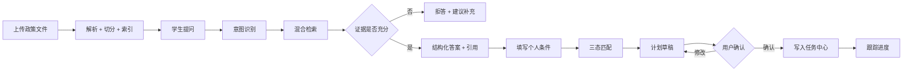
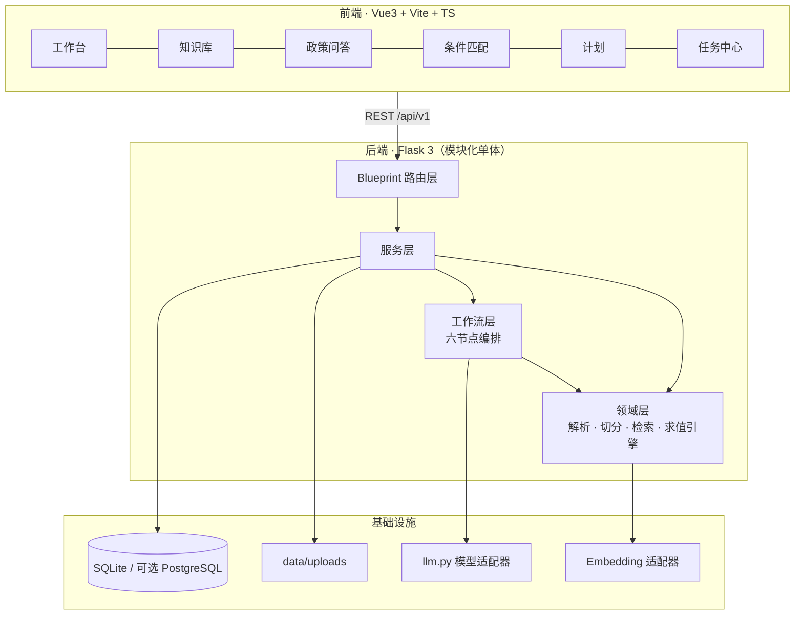

# 知校 · 校园政策智能理解与事务规划系统

> **Campus Policy Intelligence & Action Planner**
>
> 把分散的校园政策文件，转化为**有出处、可判断、可执行、可追踪**的个人事务方案。


---

## 0. 仓库状态（先读这一节）

| 项目 | 状态 |
| --- | --- |
| 合规清单 / 提交核对表 | ✅ 已完成（M0） |
| PRD、数据模型、接口契约与清单 | ✅ 已完成（M1） |
| 系统设计说明书 | ✅ V1.2 已定版（Flask 3 + Vue3） |
| 后端工程 `app/` | ✅ 可跑（M2）：应用工厂、契约外壳、13 张表、JWT 登录、`/health` |
| 前端工程 `frontend/` | ✅ 可跑（M2）：Vue3 + Vite 骨架、登录页、工作台、降级提示条 |
| 政策知识库（上传/解析/切分/索引） | ⬜ 未开始（M3） |
| 问答 / 条件匹配 / 计划 / 任务 | ⬜ 未开始（M4–M5） |
| 模型接入 | ⚠️ 未配置 → 当前运行在**降级模式**（界面顶部有常驻标识） |

> **诚实声明**：当前可用功能是**健康检查 + 登录/角色鉴权 + 数据库建表**。
> 下方"快速开始"的每条命令都已在 Windows + Python 3.13 实测通过；
> §6.6 的验证清单按"当前能做什么"重写，未实现的功能明确标注为未开放，不写成"应该可以"。
> 赛事明确禁止把未实现功能表述为已完成。
>
> 本表随里程碑更新，每次结项都对照实际代码核对一遍。

**工期**：2026-11-18 提交截止。里程碑 M0–M7 见 `04-项目实施基本流程与启动检查报告.md` §2.3。

---

## 1. 项目简介

大学生办一件事（申请奖学金、评奖评优、考试报名、学籍异动、请假证明、实习手续），通常要穿过五道断裂：

| 环节 | 真实处境 | 结果 |
| --- | --- | --- |
| 找 | 政策散在官网、学院群、PDF、办事指南 | 找不到，或找到的是上学年的旧版 |
| 读 | 正式文件长、条款嵌套、例外多 | 读不完，关键门槛记不住 |
| 判 | 条款是通用表述，不确定是否适用于自己 | 不敢申，或申了才发现不符合 |
| 办 | 材料、顺序、截止时间分散多处 | 漏材料、跑空路、错过节点 |
| 跟 | 多步骤事项没有统一跟踪 | 中断后遗忘 |

**知校**要解决的不是"查政策"，而是把政策变成一份**自己能照着做、且每一步都能回头核对原文**的清单。

产品主线只有一条：

```
政策文件 → 证据检索 → 带引用解释 → 条件结构化 → 三态匹配 → 计划草稿 → 用户确认 → 任务跟踪
```

### 与"校园 AI 聊天机器人"的区别

| 维度 | 普通政策问答 | 知校 |
| --- | --- | --- |
| 依据 | 模型自己的话 | 绑定 `文档 + 页码 + 章节 + 原文`，可点击回原文 |
| 判断 | 直接给"你能/不能" | 三态：符合 / 不符合 / **待补充或待核实**（并说明原因） |
| 输出 | 一段文字 | 结构化条件 + 任务清单 + 依赖关系 + 截止时间 |
| 信息不足 | 编一个答案 | 明确拒答，不产生任何具体数字与日期 |
| 版本 | 不感知 | 过期文件降权、冲突并列展示 |
| 判定权 | 模型 | 模型只抽取候选规则，**结论由代码计算** |

---

## 2. 核心能力

| 模块 | 能力 | 里程碑 |
| --- | --- | --- |
| 政策知识库 | PDF/DOCX/TXT/MD 上传、解析、结构化切分、元数据（部门/日期/学年/版本/状态） | M3 |
| 混合检索 | jieba 分词 BM25 + 向量余弦，RRF 融合，按有效状态过滤，冲突检测 | M4 |
| 政策问答 | 六段式结构化答案（结论/适用对象/要求/步骤/注意/来源），引用可点击 | M4 |
| 拒答机制 | 检索分低于阈值即说明"未找到足够依据"，并给可补充方向 | M4 |
| 规则抽取 | 从片段抽候选规则，`original_quote` 必须是原文子串（防伪造） | M5 |
| 三态匹配 | 8 种算子确定性求值；主观条款强制 `manual_review`，不下结论 | M5 |
| 事务计划 | 由规则生成任务草稿（材料/依赖/优先级），**用户确认后才落库** | M5 |
| 任务中心 | 列表/筛选/状态机流转/进度/来源溯源 | M5 |
| 工作流可视化 | 六节点（意图→检索→分析→匹配→规划→校验）状态、耗时、摘要 | M6（P1） |
| 降级模式 | 无模型 API Key 时主链路仍可完整演示，界面明确标注 | M2 |

### 主链路



---

## 3. 系统架构



**架构选型：模块化单体 + 自研六节点顺序编排器。**

不做微服务、不引入 Agent 框架的理由：单人开发、赛期仅 11 天，固定 6 节点顺序流程用约 60 行编排器即可覆盖，且每个节点的输入输出、耗时、失败原因全部可见——这在答辩时是可解释性优势，而不是技术落后。详见设计说明书 §3.2、ADR-01～09。

### 三条硬约束

1. `shared/` **只允许标准库**，不得 import `app`；
2. 路由层不写业务逻辑，只做参数校验 + 调用服务 + 外壳封装；
3. 只有 `app/llm.py` 允许出网调用模型。

---

## 4. 技术栈

**V1.1 定版：Flask 3 + Vue3**（理由：复用既有项目 125 接口 / JWT / 契约外壳的工程经验，工期仅 11 天）。原 FastAPI + React 方案已作废。

| 层次 | 选型 | 版本基线 | 用途 |
| --- | --- | --- | --- |
| 前端 | Vue 3 | ≥ 3.4 | SFC + `<script setup>` |
| 前端构建 | Vite | ≥ 5 | 端口 5173，`/api` 代理到 5000 |
| 前端语言 | TypeScript | ≥ 5.4 | 与后端共用 `shared/schema` 类型 |
| 前端状态 | Pinia | ≥ 2 | 仅存会话与筛选条件 |
| 图表 | ECharts | ≥ 5 | P1，M6 视工期 |
| 后端 | Flask | ≥ 3.0 | `create_app()` 工厂 + Blueprint 分域 |
| WSGI | waitress | ≥ 3.0 | 生产启动（Windows 友好） |
| 校验 | pydantic | ≥ 2.7 | 请求体、模型输出、规则 Schema |
| ORM | SQLAlchemy | ≥ 2.0 | 同一套模型切 SQLite / PostgreSQL |
| 数据库 | SQLite | 3.40+ | WAL 模式，`data/app.db` |
| 分词 | jieba | ≥ 0.42 | BM25 召回 |
| 数值 | numpy | ≥ 1.26 | 余弦相似度全量计算 |
| PDF 解析 | PyMuPDF | ≥ 1.24 | 保留页码 |
| DOCX 解析 | python-docx | ≥ 1.1 | 保留段落与标题 |
| 模型接入 | httpx（OpenAI 兼容） | ≥ 0.27 | 仅 `app/llm.py` 出网 |
| 测试 | pytest + pytest-cov | ≥ 8.0 | 单测 + 接口测试 |

> 未引入任何需要编译或额外服务的依赖（无 Docker、无向量库、无消息队列），以保证 10 分钟复现。

---

## 5. 环境要求

| 依赖 | 版本 | 检查命令 |
| --- | --- | --- |
| Python | 3.11 – 3.13 | `python --version` |
| Node.js | ≥ 18（推荐 20 LTS） | `node --version` |
| npm | ≥ 9 | `npm --version` |
| Git | ≥ 2.30 | `git --version` |

无需安装数据库，无需 Docker。模型 API Key 为**可选**。

---

## 6. 快速开始（实测约 6 分钟）

> 以下命令在 Windows 11 + Python 3.13.14 + Node 22 上逐条实测通过（2026-11-08，M2 结项）。
> Linux / macOS 用 `scripts/setup.sh` 走同一流程。

### 一键方式（推荐评审使用）

```bash
git clone https://github.com/liqing-258/campus-policy-planner.git
cd campus-policy-planner
scripts\setup.bat            # macOS/Linux: bash scripts/setup.sh
```

`setup.bat` 依次做五件事：建 `.venv` → 装依赖 → 复制 `.env` → 建 13 张表 → 写入演示账号。
每步失败即中止并打印原因。

然后两个终端分别：

```bash
scripts\start-backend.bat    # http://127.0.0.1:5000/api/v1/health
scripts\start-frontend.bat   # http://127.0.0.1:5173
```

### 手动方式（逐步核对时使用）

**① 后端依赖**

```bash
python -m venv .venv
.venv\Scripts\activate          # macOS/Linux: source .venv/bin/activate
pip install -r requirements.txt
# 国内网络加速：-i https://pypi.tuna.tsinghua.edu.cn/simple
```

**② 配置环境变量**

```bash
copy .env.example .env          # macOS/Linux: cp .env.example .env
python -c "import secrets;print(secrets.token_hex(32))"
```

把输出填进 `.env` 的 `JWT_SECRET`。`LLM_*` 留空即降级模式（功能完整，只是不做生成式回答）。

**③ 建表 + 演示数据**

```bash
.venv\Scripts\python.exe tools\init_db.py
.venv\Scripts\python.exe tools\seed_demo.py
```

真实输出（可直接对照）：

```
[db] sqlite:///.../data/app.db
[db] 表数量：13 / 期望 13
[db] PRAGMA foreign_keys=1  journal_mode=wal
[ok] 建表完成，共 13 张表
[add ] student  role=student  password=student123
[add ] admin    role=admin    password=admin123
[ok] 用户总数：2
```

**④ 环境自检**

```bash
.venv\Scripts\python.exe tools\selfcheck.py
```

20 项检查，任一项 FAIL 都会给出具体修法。看到最后一行
`结论：环境就绪` 再往下走。

**⑤ 启动**

```bash
# 终端 1
.venv\Scripts\python.exe server.py          # 也可用 scripts\start-backend.bat

# 终端 2
cd frontend && npm install && npm run dev   # 也可用 scripts\start-frontend.bat
```

| 服务 | 地址 |
| --- | --- |
| 前端 | http://127.0.0.1:5173 |
| 后端健康检查 | http://127.0.0.1:5000/api/v1/health |
| 接口清单 | `docs/30-接口契约/接口清单.md` |

### 6.6 验证清单（当前已实现的部分）

**命令行验证（约 1 分钟）**

```bash
# 1. 健康检查：code=0，llm_mode=degraded（因未配 Key）
curl http://127.0.0.1:5000/api/v1/health

# 2. 登录拿令牌
curl -X POST http://127.0.0.1:5000/api/v1/auth/login ^
  -H "Content-Type: application/json" ^
  -d "{\"username\":\"student\",\"password\":\"student123\"}"

# 3. 用令牌查身份（把 <TOKEN> 换成上一步返回值）
curl http://127.0.0.1:5000/api/v1/auth/me -H "Authorization: Bearer <TOKEN>"

# 4. 不带令牌访问 → 401 + code 3001
curl http://127.0.0.1:5000/api/v1/auth/me
```

**界面验证（约 2 分钟）**

1. 打开 http://127.0.0.1:5173 → 顶部出现黄色**降级模式**提示条（未配 Key 时的正确行为）；
2. 用 `student / student123` 登录 → 进入工作台；
3. 工作台「系统状态」卡片显示 `db=ok`、`模型模式=degraded`、政策文件 `0 份`；
4. 退出后访问 `/` → 被重定向回登录页（前端路由守卫）。

**自动化验证**

```bash
.venv\Scripts\python.exe -m pytest        # M2 阶段 31 项全绿
.venv\Scripts\python.exe tools\dump_routes.py   # 真实接口数（M2 为 3 条）
```

> **未开放的功能不在此列出**：政策上传/解析（M3）、问答（M4）、条件匹配与计划（M5）
> 尚未实现，界面上也没有对应入口——不画"点了会报错"的空壳按钮。

### 6.7 验证一条完整链路（M4 完成后可用，约 3 分钟）

1. 用 `student / student123` 登录；
2. 进「政策知识库」，确认演示文档状态为 `indexed`；
3. 进「AI 政策问答」，提问：**"申请国家励志奖学金需要满足哪些条件，要交什么材料？"**；
4. 点击引用卡片，确认能打开对应原文片段；
5. 提一个知识库里没有的问题（如"转专业后已修学分如何认定"），确认系统**拒答而不编造**；
6. 进「条件匹配」，填写虚构条件，查看三态结果；
7. 生成计划草稿 → 编辑 → 确认 → 在任务中心完成一项任务。

---

## 7. 环境变量

完整模板见 `.env.example`。核心项：

| 变量 | 必填 | 缺省行为 |
| --- | --- | --- |
| `JWT_SECRET` | ✅ | 启动失败并提示生成方法 |
| `DATABASE_URL` | ❌ | `sqlite:///./data/app.db` |
| `LLM_BASE_URL` / `LLM_API_KEY` / `LLM_MODEL` | ❌ | 任一为空 → 降级模式，界面常驻提示 |
| `EMBEDDING_MODEL` | ❌ | 仅 BM25 检索 |
| `RAG_TOP_K` | ❌ | 6 |
| `RAG_MIN_SCORE` | ❌ | 0.35（拒答阈值） |
| `CHUNK_SIZE` / `CHUNK_OVERLAP` | ❌ | 600 / 80 |
| `MAX_UPLOAD_MB` | ❌ | 20 |
| `DEMO_BANNER` | ❌ | true（顶部显示"演示数据"标识） |

> **安全**：`.env` 已在 `.gitignore` 中；仓库只保留 `.env.example` 占位值。

---

## 8. 数据库与演示数据

```bash
# 建库（幂等，可重复执行）
python tools/init_db.py

# 导入虚构演示数据
python tools/seed_demo.py

# 重建（清空后重导，仅开发环境）
python tools/seed_demo.py --reset
```

**13 张表**：`users`、`documents`、`document_chunks`、`conversations`、`messages`、`policy_rules`、`match_sessions`、`match_result_items`、`action_plans`、`tasks`、`workflow_runs`、`qa_feedback`，另有 `audit_logs`。字段与索引见 `docs/20-系统设计/数据模型.md`。

| 演示文件 | 类型 | 用途 |
| --- | --- | --- |
| `demo/奖学金评审办法（演示样例）.pdf` | 10 页，含条件/材料/流程章节 | 主链路演示 |
| `demo/评奖评优实施细则（演示样例）.docx` | 5 页 | 多格式解析 + 版本冲突演示 |
| `demo/空文本样例（演示样例）.pdf` | 扫描件模拟 | 异常分支演示 |

> 以上文件**全部虚构**，不来自任何真实院校，仅用于功能演示。标题统一带"（演示样例）"。

---

## 9. 启动命令

| 场景 | 命令 |
| --- | --- |
| 后端开发 | `python run.py` |
| 后端生产 | `waitress-serve --port=5000 --call app:create_app` |
| 前端开发 | `cd frontend && npm run dev` |
| 前端构建 | `cd frontend && npm run build` |
| 前端类型检查 | `cd frontend && npm run typecheck` |
| 一键启动（Windows） | `scripts\start-backend.bat` + `scripts\start-frontend.bat` |
| 一键启动（macOS/Linux） | `bash scripts/start-backend.sh` + `bash scripts/start-frontend.sh` |

---

## 10. 验证方式（分档）

```bash
# 1. 单元测试：切分、BM25 打分、8 算子、状态机、Schema 校验、引用白名单
pytest tests/unit -v

# 2. 接口测试：上传→解析→检索、问答→校验、匹配→计划→任务
pytest tests/api -v

# 3. 覆盖率
pytest --cov=app --cov-report=term-missing

# 4. 边界用例（24 条，T-01～T-24）
pytest tests/edge -v

# 5. 契约自检：接口数与清单一致、错误码覆盖
python tools/check_contract.py

# 6. 前端类型检查 + 构建
cd frontend && npm run typecheck && npm run build
```

| 档 | 内容 | 通过标准 |
| --- | --- | --- |
| 1 | 单元 | 核心分支 100%，整体 ≥ 60% |
| 2 | 接口 | 主链路全通 |
| 3 | 边界 | T-01–T-24 有执行记录，失败项如实登记 |
| 4 | 评测集 | 24 条问答，拒答正确率 ≥ 90%，引用越界 = 0 |
| 5 | 契约 | 接口数一致，无未登记接口 |
| 6 | 复现 | 干净环境 ≤ 10 分钟完成核心演示 |

---

## 11. 目录结构

```text
campus-policy-planner/
├── app/                        # Flask 应用（扁平按域一文件）
│   ├── __init__.py             # ✅ create_app 工厂 + 蓝图注册 + dump_routes
│   ├── config.py               # ✅ 配置集中读取（唯一 os.getenv 出口）
│   ├── contract.py             # ✅ 统一响应外壳（唯一实现）
│   ├── errors.py               # ✅ 错误码与异常体系
│   ├── runtime.py              # ✅ 请求内/脚本外统一的配置访问
│   ├── schemas.py              # ✅ pydantic v2 请求契约
│   ├── models.py               # ✅ SQLAlchemy 模型（13 张表）
│   ├── auth.py                 # ✅ JWT、角色守卫、登录
│   ├── health.py               # ✅ /health
│   ├── documents.py            # ⬜ M3 上传 / 列表 / 删除
│   ├── parsing.py              # ⬜ M3 PDF / DOCX / TXT 解析
│   ├── chunking.py             # ⬜ M3 结构化切分
│   ├── retrieval.py            # ⬜ M4 BM25 + 向量 + RRF
│   ├── qa.py                   # ⬜ M4 结构化问答 + 引用校验
│   ├── rules.py                # ⬜ M5 规则抽取 + 三态求值
│   ├── plans.py                # ⬜ M5 计划草稿 / 确认
│   ├── tasks.py                # ⬜ M5 任务 CRUD 与状态机
│   ├── workflows.py            # ⬜ M6 六节点编排 + run 轨迹
│   └── llm.py                  # ⬜ M4 模型适配器（可降级）
├── shared/                     # 纯标准库，前后端共用
│   ├── enums.py                # ✅ 状态与算子枚举 + 转移白名单
│   ├── codes.py                # ✅ 错误码常量
│   └── schema/                 # ⬜ JSON Schema
├── frontend/                   # Vue3 + Vite
│   └── src/{api,stores,views}
├── data/                       # app.db + uploads/（不入库）
├── demo/                       # ⬜ 虚构演示文档（M3 生成，入库）
├── docs/                       # 文档体系（00~90 编号）
├── tools/                      # ✅ init_db / seed_demo / selfcheck / dump_routes
├── scripts/                    # ✅ setup / start-backend / start-frontend（.bat + .sh）
├── tests/                      # ✅ 契约 / 鉴权 / 健康检查 / 密钥扫描
├── requirements.txt
├── .env.example
├── .gitignore
├── server.py                   # 启动入口（waitress）
├── pytest.ini
└── README.md
```

> ✅ = 已实现且有测试或实测；⬜ = 尚未实现。这份树不允许"先画再写"——M2 只勾了真正跑起来的部分。

---

## 12. 接口速览

基础路径 `/api/v1`。设计总量 **30 条**，**当前已实现 3 条**（下表粗体行）。
已实现条数不允许手填，用脚本导出核对：

```bash
.venv\Scripts\python.exe tools\dump_routes.py --prefix /api/v1
# 合计 3 条  按方法：GET 2 / POST 1
```

除 `/health`、`/auth/login` 外需 `Authorization: Bearer <token>`。

| 方法 | 路径 | 说明 | 状态 |
| --- | --- | --- | --- |
| **GET** | **`/health`** | **健康检查（DB、模型模式、片段数）** | ✅ M2 |
| **POST** | **`/auth/login`** | **登录，签发 JWT** | ✅ M2 |
| **GET** | **`/auth/me`** | **当前用户与角色** | ✅ M2 |
| POST | `/documents` | 上传（admin） | ⬜ M3 |
| GET | `/documents` | 列表 | ⬜ M3 |
| GET | `/documents/{id}` | 详情 | ⬜ M3 |
| DELETE | `/documents/{id}` | 软删除（admin） | ⬜ M3 |
| POST | `/documents/{id}/reparse` | 重新解析（admin） | ⬜ M3 |
| GET | `/documents/{id}/chunks` | 片段列表 | ⬜ M3 |
| GET | `/chunks/{id}` | 单片段 + 定位 | ⬜ M3 |
| POST | `/retrieval/search` | 纯检索（调试） | ⬜ M4 |
| POST | `/qa/ask` | 提问，返回答案 + 引用 + 轨迹 | ⬜ M4 |
| GET | `/conversations` | 会话列表 | ⬜ M4 |
| GET | `/conversations/{id}/messages` | 消息列表 | ⬜ M4 |
| POST | `/messages/{id}/feedback` | 答案反馈 | ⬜ M6 |
| POST | `/documents/{id}/rules/extract` | 规则抽取（admin） | ⬜ M5 |
| GET | `/documents/{id}/rules` | 规则列表 | ⬜ M5 |
| PATCH | `/rules/{id}` | 修正规则（admin） | ⬜ M5 |
| POST | `/matches` | 三态匹配 | ⬜ M5 |
| GET | `/matches/{id}` | 匹配详情 | ⬜ M5 |
| POST | `/plans/draft` | 计划草稿（不落库） | ⬜ M5 |
| POST | `/plans/{id}/confirm` | 确认计划（落库） | ⬜ M5 |
| GET / PATCH | `/plans`、`/plans/{id}` | 计划列表与编辑 | ⬜ M5 |
| GET / POST | `/tasks` | 任务列表 / 手工新增 | ⬜ M5 |
| PATCH | `/tasks/{id}` | 编辑任务 | ⬜ M5 |
| POST | `/tasks/{id}/status` | 状态流转 | ⬜ M5 |
| GET | `/tasks/stats` | 进度统计 | ⬜ M6 |
| GET | `/workflows/{run_id}` | 工作流轨迹 | ⬜ M6 |

**错误码**：0 成功 / 1xxx 参数 / 2xxx 资源 / 3xxx 权限 / **4xxx AI 链路（4001 证据不足、4002 输出非法、4003 引用越界、4004 超时、4005 上游错误、4006 降级中）** / 9xxx 系统。详见 `docs/30-接口契约/接口契约统一规范.md`。

---

## 13. 演示流程（约 7 分钟，用于录视频）

| 时间 | 内容 | 展示要点 |
| --- | --- | --- |
| 0:00–0:45 | 痛点：找-读-判-办-跟五断点 | 讲清"为什么不能用通用大模型" |
| 0:45–1:20 | 主链路图 + 架构图 | 30 秒说明全貌 |
| 1:20–3:20 | 上传 → 解析 → 提问 → 点开引用 → **拒答演示** | 拒答是核心差异化，必须演 |
| 3:20–4:30 | 填条件 → 三态结果（含 `unknown`）→ 计划草稿 → 确认 → 完成任务 | 证明闭环 |
| 4:30–6:30 | **真实 AI 协作录屏**：一段 Prompt 生成引用校验模块 + 一个 Bug 定位修复 | 赛事硬要求，不可用截图代替 |
| 6:30–7:00 | 测试结果、Git 历史、10 分钟复现 | 证明可复现 |

---

## 14. 常见问题（FAQ）

**Q1：没有模型 API Key 能跑起来吗？**
能。系统进入**降级模式**：上传、解析、检索、三态匹配、计划、任务均可用，仅"自然语言生成答案"替换为"检索原文直出"。界面顶部常驻"未启用 AI 生成"，不会伪装。

**Q2：为什么用 SQLite 而不是 PostgreSQL？**
10 分钟复现是硬指标。SQLite 零安装、单文件、可随仓库分发演示数据。所有查询经 SQLAlchemy 编写，改 `DATABASE_URL` 即可切换。

**Q3：为什么不用 pgvector / Milvus？**
本项目检索规模 < 2 万片段，全量内存余弦完全够用，且省掉向量库的安装与运维。检索层抽象为 `Retriever` 接口，可替换实现。

**Q4：为什么不直接用大模型判断"我是否符合条件"？**
资格判断是法律责任敏感行为，必须可复现、可解释、可测试。模型输出会漂移，无法写断言，也无法向用户解释"为什么判我不符合"。因此模型只**抽取候选规则**，结论由代码按 8 种算子确定性计算。主观条款（"表现突出"）强制 `manual_review`，系统主动放弃判断。

**Q5：AI 会产生幻觉吗？怎么控制？**
不声称"消除幻觉"。做法是让幻觉**无法通过校验进入答案**：① 引用必须属于本次检索集合（白名单）；② 规则的 `original_quote` 必须是片段原文子串；③ 答案中的数字/日期回查原文，命中率低则降级置信说明；④ 证据不足直接拒答。四道闸在代码里，不依赖提示词的自觉。

**Q6：文档里夹带"忽略以上指令"会怎样？**
被当作普通文本处理。证据块用定界符隔离，Prompt 首尾两次声明其为资料而非指令；日志记录 `prompt_injection_suspected`，该片段降权。

**Q7：为什么计划要先草稿再确认？**
AI 生成的任务可能遗漏或过度解读。让用户先看、先改、再确认，既尊重用户对个人事务的决定权，也避免系统"替用户承诺"。未确认的草稿不写入任务表。

**Q8：可以用真实学校的政策文件吗？**
可以，但需为公开发布的文件并遵守学校规定。仓库自带的演示文件**全部虚构**，标题带"（演示样例）"。

**Q9：为什么选 Flask + Vue3 而不是 FastAPI + React？**
工期只有 11 天，既有项目已用 Flask 做过 125 个接口、JWT、统一契约外壳，Vue3+Vite 也已有骨架。换栈需重建约 1.5–2 天，收益不抵成本。校验能力用 pydantic v2 单独接入即可补上。详见 `04-项目实施基本流程与启动检查报告.md` §3.3。

---

## 15. 已知限制

### 15.1 当前里程碑（M2）的阶段性限制

1. **只实现了 3 条接口**：`/health`、`/auth/login`、`/auth/me`。政策库、问答、匹配、计划、任务全部未实现，前端也没有对应入口。
2. **前端只有两个页面**：登录页与工作台。工作台里的"政策文件 0 份"是真实读数，不是占位数字。
3. **登录限流是进程内内存实现**：重启即清零，多实例部署会失效（需换 Redis）。当前足以防住脚本暴力尝试。
4. **SQLite 单写者**：并发写入靠 `busy_timeout=5000` 排队，不做连接池分片。演示规模（单用户操作）不构成问题。
5. **没有 Alembic 迁移**：建表用 `tools/init_db.py`。改字段需 `--drop` 重建，会清空数据。

### 15.2 项目整体限制（贯穿全部里程碑）

1. **不支持扫描件 OCR**。无文本层的 PDF 标记为"疑似扫描件"并提示，不静默失败，也不假装解析成功。
2. **复杂表格解析不完整**。多栏、合并单元格可能丢失结构，答案中提示"表格内容建议核对原文"。
3. **规则抽取依赖模型**。降级模式下抽取能力显著下降，仅提供关键词模板。
4. **仅覆盖单一场景深度**。MVP 以"奖学金申请"为主演示场景，其余事务支持检索问答，但规则库不完整。
5. **不接教务/学工系统**。条件由用户手动填写，系统无法自动核验成绩与学籍。
6. **不做资格认定**。匹配结果仅为辅助判断，最终以学校与学院评审为准。
7. **单机部署**。未做水平扩展与高并发优化。
8. **中文分词对专业术语有误切风险**，影响 BM25 召回，已用章节标题命中加权部分缓解。
9. **检索规模上限约 5 万片段**，超过需引入近似检索。

---

## 16. 安全与合规

| 事项 | 做法 |
| --- | --- |
| 密钥 | 仅从环境变量读取；`.env` 不入库；仓库只留 `.env.example` 占位值 |
| 文件 | 扩展名白名单 + 文件头魔数校验 + 大小上限 + 重命名存储 + 下载走鉴权接口 |
| 文档内容 | 视为**不可信数据**，不执行、不作为指令、不参与配置 |
| 模型输出 | 经 pydantic + 引用白名单校验后才落库 |
| 个人信息 | 最小必要采集（学籍类型/年级/绩点/排名等），字段走白名单；不采集身份证号、手机号 |
| 权限 | 学生/管理员两角色。**角色不足返回 3002/403**；**访问他人资源返回 2002/404**（不暴露资源是否存在，见 US-09） |
| 演示数据 | 全部虚构，页面与文档双重标注 |
| 免责 | 匹配与计划页面固定展示"仅辅助参考，不替代学校正式认定" |

---

## 17. 开发过程留痕

按赛事要求保留**真实**过程，不做事后包装。

- **Git**：细粒度提交，每次对应一个可验证增量或一条 Prompt 链；禁止一次性 `initial commit`。全量日志与粒度自证见 `docs/00-合规与提交/Git提交日志.md`，M0–M7 计划 37–54 次提交（已完成 8 次）。
- **Prompt 留痕**：索引与合规判定见 `docs/90-AI协作留痕/00-AI对话历史总档.md`。当前已落盘 A–E 五条链（设计/工程），核心功能链 F-1～F-3 在 M3–M5 逐条追加，每条含原始 Prompt、AI 修改建议、引导修复 Bug 的过程、验证结果与对应 commit。
- **证据归档**：会话截图与录屏存 `docs/90-AI协作留痕/evidence/`，命名与遮挡规范见该目录 README。
- **可复现**：新环境按本 README 完成核心演示 ≤ 10 分钟。

---

## 18. 文档索引

| 文档 | 说明 |
| --- | --- |
| `docs/00-合规与提交/比赛合规清单.md` | 赛题规则、6 项提交材料、7 条红线、11 天倒排、提交核对表 |
| `docs/00-合规与提交/提交材料清单.md` | **6 项材料制作台账**：规格、产出位置、完成判据、截止日、11-18 当天动作序列 |
| `docs/00-合规与提交/风险登记表.md` | 16 条风险 × 状态 × 复查点、P0 信号监控、状态变更记录 |
| `docs/00-合规与提交/Git提交日志.md` | **提交全量日志**：实算统计、粒度自证、提交↔对话映射、M2–M7 提交计划、评审复核命令 |
| `docs/00-合规与提交/M0M1门禁自检报告.md` | M0 三项 + M1 七项逐条实测、6 处缺陷与修复、可复跑脚本 |
| `docs/10-需求分析/PRD.md` | P0/P1/P2、10 条用户故事与可判定验收标准、需求追溯矩阵（V1.1） |
| `docs/10-需求分析/用户旅程.md` | 两角色、五道断裂、情绪曲线、三个关键时刻、旅程→功能覆盖检查 |
| `docs/20-系统设计/系统设计说明书.md` | **主文档**：架构、流程、数据、接口、AI 策略、安全、测试、部署（V1.2） |
| `docs/20-系统设计/数据模型.md` | 13 张表字段、枚举、状态机、SQLite 约定（V1.1） |
| `docs/30-接口契约/接口契约统一规范.md` | 外壳、错误码、分页、幂等、鉴权 |
| `docs/30-接口契约/接口清单.md` | 30 条接口 × 角色 × 里程碑 × 错误码 |
| `docs/90-AI协作留痕/00-AI对话历史总档.md` | **Prompt 留痕索引**：导出方案、证据台账、三要素检查、功能链补齐门禁 |
| `docs/90-AI协作留痕/01-需求与架构.md` | 链 A–C：需求与架构、工程惯例迁移、技术栈定版 |
| `docs/90-AI协作留痕/02-工程质量与故障修复.md` | 链 D–E：文档三类缺陷、Git 推送两个被证伪的假设 |
| `docs/90-AI协作留痕/03-M0M1收尾与门禁自检.md` | 链 G：按门禁实测补齐产物，含 4 个返工回合 |
| `docs/90-AI协作留痕/evidence/` | 会话截图与录屏归档（含命名与遮挡规范） |
| `04-项目实施基本流程与启动检查报告.md` | 工程惯例、7 里程碑、11 天排期、五问答复、决议记录 |
| `01/02/03-*.md` | 项目介绍、实施框架、分阶段提示词（规划期材料） |

---

## 19. 许可证

本项目代码为原创实现，遵循仓库内 `LICENSE`（MIT）。第三方开源依赖遵守其各自许可证，清单见 `docs/third-party-notices.md`（M2 产出）。未复制任何现成开源项目作为作品主体。演示政策文件为虚构样例，不涉及第三方著作权。

---

<p align="center">
<b>知校</b> · 不是替你做决定，而是让每个决定都有出处。
</p>
