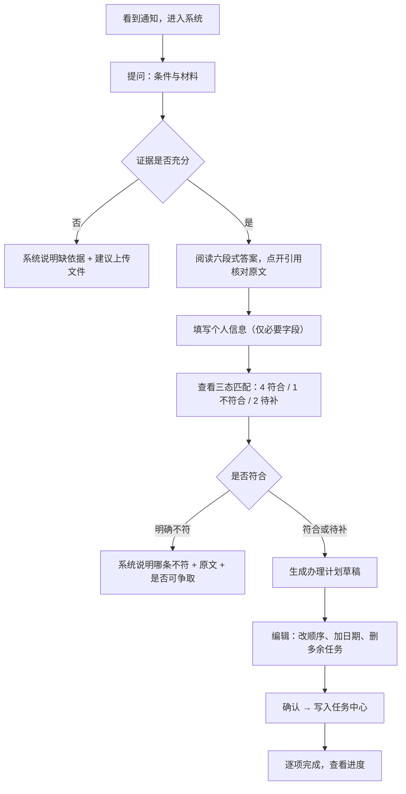

# 产品需求文档（PRD）

> 项目：知校 · 校园政策智能理解与事务规划系统
> 文档版本：V1.1
> 编制日期：2026-11-07
> 对应里程碑：M1（设计冻结）
> 上游依据：`01-项目介绍文档.md`、`docs/20-系统设计/系统设计说明书.md` V1.2
> 下游约束：M2 起的一切代码实现以本文的功能编号与验收标准为准

---

## 修订记录

| 版本 | 日期 | 修订内容 |
| --- | --- | --- |
| V1.0 | 2026-11-07 | 首版：锁定单场景（奖学金申请）闭环，P0 九项，验收标准可判定化 |
| V1.1 | 2026-11-07 | M1 门禁自检修复：P0 口径"九项"→"十项"（实为 F-01～F-10）；**补 US-09（登录与角色隔离）、US-10（知识库管理）**，堵住 F-01/F-05 无验收标准的缺口；追溯矩阵补齐 F-01/F-05 两行 |

---

## 1. 产品定义

### 1.1 一句话

把分散在通知、规章、办事指南、PDF 里的校园政策，转化为**有出处、可判断、可执行、可追踪**的个人事务方案。

### 1.2 用户与痛点

| 角色 | 是谁 | 他的一天 | 核心痛点 |
| --- | --- | --- | --- |
| 学生（主） | 在校本科生/研究生 | 看到群里的奖学金通知，想申请，但不知道够不够格、要交什么、什么时候截止 | 五道断点：找不到 / 读不完 / 判不准 / 办不明 / 跟不住 |
| 管理员 | 学院教务或学工老师 | 上传政策、维护版本 | 旧文件易混淆、条款无法结构化沉淀 |
| 评审（外部） | 比赛评委 | 10 分钟内判断作品真伪与价值 | 需要一眼看到闭环与真实的 AI 协作过程 |

### 1.3 场景收敛

**MVP 只做一条完整链路：奖学金申请。** 其余场景（评奖评优、考试报名、学籍异动、请假证明、实习就业）只提供检索与问答，不保证规则完整。

理由：赛事 50% 分数压在"闭环 + 可复现"，一个场景做到 100% 远胜五个场景各 30%。

### 1.4 与替代方案的价值差

| 用户现在的做法 | 代价 | 知校给的 |
| --- | --- | --- |
| 翻 5 个群 + 官网搜 | 20–40 分钟，仍可能看旧版 | 一次提问，返回结构化答案 + 原文坐标 |
| 问学长 | 信息可能过时、不权威 | 结论绑定本校文件页码 |
| 直接问通用大模型 | 会编造门槛、金额、日期 | 无证据即拒答；有证据才陈述 |
| 自己列 Excel 清单 | 漏材料、忘记截止 | 自动生成任务 + 依赖 + 来源 |

---

## 2. 功能需求

优先级定义：**P0** = 缺此闭环断裂；**P1** = 显著提升可信度与体验，11-13 后可砍；**P2** = 明确不做。

### 2.1 P0 功能清单（十项，F-01～F-10）

| 编号 | 功能 | 描述 | 依赖 | 里程碑 |
| --- | --- | --- | --- | --- |
| F-01 | 登录与角色 | JWT 登录；预置 `student` / `admin` 两个演示账号；所有查询强制按 `user_id` 隔离 | — | M2 |
| F-02 | 政策文件上传 | PDF/DOCX/TXT/MD 白名单；魔数校验；≤20MB；重命名存储 | F-01 | M3 |
| F-03 | 文档解析 | 提取文本；PDF 保留页码；DOCX 保留段落与标题；加密/扫描件给明确失败原因 | F-02 | M3 |
| F-04 | 结构化切分与索引 | 按标题/条款切分，chunk 带 `page_number`/`section_title`/字符偏移；生成 BM25 索引与向量 | F-03 | M3 |
| F-05 | 知识库浏览 | 列表、筛选（状态/学年/部门）、片段预览、删除（管理员） | F-04 | M3 |
| F-06 | 混合检索 | jieba 分词 BM25 + 向量余弦，RRF 融合；按 `effective_status` 过滤；冲突检测 | F-04 | M4 |
| F-07 | 带引用问答 | 六段式结构化答案；引用可点击定位；引用 ID 必须在本次检索集合内 | F-06 | M4 |
| F-08 | 拒答与降级 | 检索分低于阈值 → 明确拒答；模型不可用 → 检索直出并标注 | F-06 | M4 |
| F-09 | 规则抽取与三态匹配 | 从片段抽候选规则（`original_quote` 须为原文子串）；代码按 8 算子求值；输出 met/not_met/unknown + 理由 | F-06 | M5 |
| F-10 | 计划与任务 | 规则 → 任务草稿（材料/依赖/优先级/截止）；用户确认后落库；任务状态机 + 进度 | F-09 | M5 |

> 注：早期版本按 S-1～S-9 表述为"九项"，实际为 10 条（F-01～F-10）——"拒答"从问答中独立成条以便单独验收。此口径在 M1 门禁自检时更正。

### 2.2 P1 功能（11-13 硬分界后视工期）

| 编号 | 功能 | 价值 | 风险 |
| --- | --- | --- | --- |
| F-11 | 六节点工作流可视化 | 直接对应"AI 响应状态友好"15% 体验分 | 易做成假进度条，需真实 `node_traces` |
| F-12 | 政策版本与冲突管理 | 防旧文件误导，差异化点 | 增加文档元数据维护成本 |
| F-13 | 问答反馈（有用/无用） | 支撑评测与迭代叙事 | 低 |
| F-14 | 任务日历视图 | 展示层加分 | 低，但非必需 |
| F-15 | 管理员规则复核台 | 体现"规则需人工确认"的严谨性 | 中，页面成本高 |
| F-16 | ECharts 统计页 | 复用既有经验，观感提升 | 纯装饰，最先砍 |

### 2.3 P2（明确不做，答辩时主动说明）

对接教务/学工/统一身份认证；自动提交真实申请；自动发送通知；复杂 RBAC；移动端原生 App；多学校多租户；扫描件 OCR。

---

## 3. 用户故事与验收标准

验收标准必须**可判定**（能写成断言或人工逐项打勾），不接受"体验良好""基本可用"。

| 编号 | 用户故事 | 验收标准 | 关联 |
| --- | --- | --- | --- |
| US-01 | 作为管理员，我上传一份奖学金政策 PDF，系统解析成可检索片段 | ① 上传后 ≤15s 状态变为 `indexed`；② `chunk_count > 0`；③ 每条片段有 `page_number`；④ 列表可预览前 100 字 | F-02/F-03/F-04 |
| US-02 | 作为学生，我问"申请条件是什么、要交哪些材料"，得到带出处的回答 | ① 答案含 6 个字段（结论/适用对象/要求/步骤/注意/来源）；② `citations.length ≥ 1`；③ 每个 `citation.chunk_id` ∈ 本次检索集合；④ 点击引用能打开对应片段并高亮 | F-06/F-07 |
| US-03 | 作为学生，我问知识库里没有的问题，系统不能编造 | ① `direct_answer` 含"未找到足够依据"；② `citations == []`；③ 全文不含任何数字型门槛/日期/金额（正则校验 `\d+(分|元|%|月|日)` = 0 命中）；④ 给出 ≥1 条可补充建议 | F-08 |
| US-04 | 作为学生，我输入自己的情况，看到逐条符合/不符合/待补充 | ① 每条规则一行，含状态、理由、原文、用户值；② 缺字段的规则状态必须为 `unknown` 且 `unknown_reason=missing_info`；③ 主观条款为 `unknown/ambiguous_rule`；④ 页面显示免责声明 | F-09 |
| US-05 | 作为学生，我把政策要求变成任务清单，能改、能确认 | ① 草稿可编辑（标题/优先级/日期/删除）；② 未确认时 `/tasks` 查不到这些任务；③ 确认后 `plan.status=confirmed` 且任务出现；④ 无来源的 `due_at` 必须为 `null` 并提示补充；⑤ 依赖成环时确认被拒（422） | F-10 |
| US-06 | 作为学生，我看任务进度和它对应的政策来源 | ① 任务详情可跳转到来源 chunk；② 完成比例 = done / (total − cancelled)，计算正确 | F-10 |
| US-07 | 作为评审，我按 README 在 10 分钟内跑起来 | ① clone → 看到第一条带引用答案 ≤ 10 分钟（不含申请 Key 时间）；② 无 Key 环境下主链路仍可演示且界面有降级标识 | 全局 |
| US-08 | 作为学生，我看到的答案若来自过期文件，系统要提示 | ① `superseded` 文档的片段降权 50%；② 答案 `caveats` 必须含"该文件已被更新版本替代" | F-06/F-12 |
| US-09 | 作为学生，我只能看到自己的数据，看不到别人的 | ① 无 token 访问 `/api/v1/tasks` 返回 401；② student A 用 student B 的 `plan_id` 请求返回 404（不用 403，避免泄露资源存在性）；③ `/tasks` 的 `total` 等于本人任务数，不含他人；④ admin 调用同一接口可按角色读到全部用户数据；⑤ 越权用例写入自动化测试，不允许只靠人工点 | F-01 |
| US-10 | 作为管理员，我能管理知识库文档并安全删除 | ① `GET /documents?status=indexed` 返回条数与库内该状态条数一致；② 片段预览返回前 100 字，不越界、不整段泄露；③ admin `DELETE /documents/{id}` 为软删除，`deleted_at` 非空且列表不再出现；④ 删除后历史消息的 `citations_json` 仍可读（不破坏引用可追溯）；⑤ student 调用 DELETE 返回 403 | F-05 |

---

## 4. 关键流程（用户视角）

### 4.1 主旅程：奖学金申请

### 4.2 异常旅程（必须实现，不是可选项）

| 场景 | 系统行为 |
| --- | --- |
| 上传扫描件（无文本层） | 状态 `empty`，提示"未提取到文本，疑似扫描件，建议 OCR 后重传"，不产生空片段 |
| 提问超出知识库 | 拒答 + 建议清单，绝不编造 |
| 同一主题两版文件 | 并列展示两版，标注发布日期与状态，不静默择一 |
| 用户缺关键字段 | 该条 `unknown/missing_info`，其余条目照常判定 |
| 政策表述主观（"表现突出"） | `unknown/ambiguous_rule`，提示向学院确认 |
| 模型超时/返回非 JSON | 一次修复重试 → 仍失败则检索直出，界面标注"AI 生成失败，以下为原文" |

---

## 5. 页面清单

| 页面 | 路由 | 核心内容 | 必须具备的状态 |
| --- | --- | --- | --- |
| 登录 | `/login` | 账号密码，演示账号提示 | 错误提示 |
| 工作台 | `/` | 待办数、最近问答、知识库状态 | 空状态（新用户） |
| 政策知识库 | `/library` | 文档表格、上传入口 | 加载/空/失败/上传进度 |
| 政策详情 | `/documents/:id` | 元数据、片段列表、定位 | 解析失败原因 |
| AI 政策问答 | `/ask` | 对话流、引用卡片、节点轨迹 | 拒答态/降级态/重试 |
| 条件匹配 | `/match` | 信息表单 → 三态结果 | 缺字段高亮/免责声明 |
| 事务计划 | `/plan` | 草稿卡片，可编辑排序 | 未确认提示 |
| 任务中心 | `/tasks` | 列表 + 筛选 + 进度 | 空/完成态 |
| 资料管理 | `/admin` | 规则复核、重建索引、删除 | 仅管理员可见 |

---

## 6. 非功能需求

| 编号 | 类别 | 指标 | 验证方式 |
| --- | --- | --- | --- |
| NFR-1 | 性能 | 单文档（≤20 页）解析+切分+索引 ≤15s | 服务端计时日志 |
| NFR-2 | 性能 | 问答 P95 ≤12s；纯检索 P95 ≤800ms | 接口计时 |
| NFR-3 | 可用性 | 无模型 Key 时主链路可用，界面有降级标识 | 断 Key 实测 |
| NFR-4 | 正确性 | 引用越界数 = 0 | 白名单校验 + 用例 |
| NFR-5 | 可复现 | 干净环境 ≤10 分钟完成核心演示 | 陌生目录实测计时 |
| NFR-6 | 安全 | 仓库内密钥/隐私 = 0 条 | `git grep` 扫描 |
| NFR-7 | 可测 | 核心服务单测覆盖率 ≥60% | pytest-cov |

---

## 7. 明确不做（Out of Scope）

1. 不做学校官方资格认定，结论仅为辅助；
2. 不接教务/学工/统一身份认证；
3. 不代用户提交任何真实申请；
4. 不覆盖全校全部事务，只做单场景深度 + 多场景检索；
5. 不做复杂 RBAC（仅两角色）；
6. 不做移动端原生 App；
7. 不使用真实学生隐私数据；
8. 不做扫描件 OCR（只提示，不假装成功）。

---

## 8. 需求追溯矩阵（PRD → 设计 → 测试）

| 需求 | 设计章节 | 验收用例 | 测试编号 |
| --- | --- | --- | --- |
| F-01 登录与角色 | §8 安全、§6.1 鉴权约定 | US-09 | T-21/22 |
| F-02 上传 | 说明书 §4.2、§6.2 | US-01 | T-01/02/06 |
| F-03 解析 | §4.2 | US-01 | T-03/04/05/07 |
| F-04 切分索引 | §5.2 document_chunks | US-01 | T-06 |
| F-05 知识库浏览 | §4.2、§6.2 | US-10 | T-01/06 |
| F-06 检索 | §7.2 | US-02/08 | T-08/09/12 |
| F-07 问答 | §7.3–7.4 | US-02 | T-09/10/11 |
| F-08 拒答 | §4.6、§7.7 | US-03 | T-08/23 |
| F-09 规则匹配 | §4.4、§7.5 | US-04 | T-13/14/15 |
| F-10 计划任务 | §4.5 | US-05/06 | T-16–T-22 |
| 全局安全 | §9 | — | T-21/22/24 |
