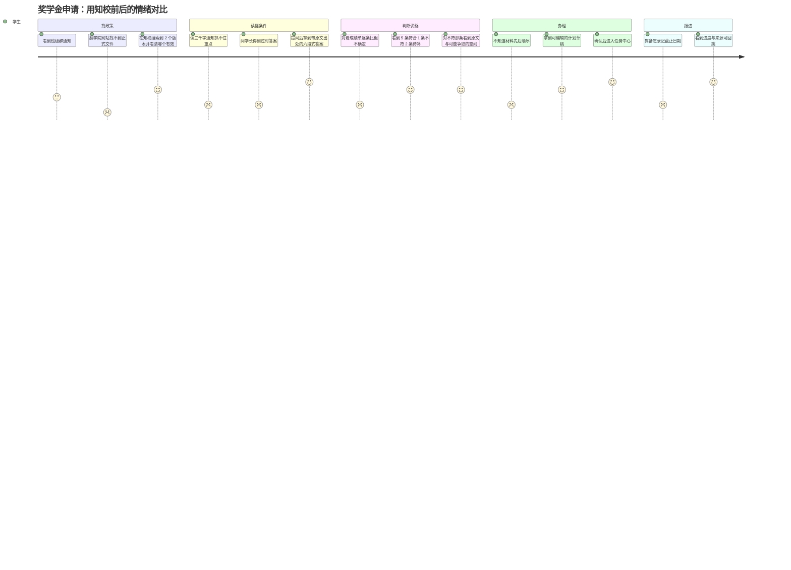

# 用户旅程（User Journey）

> 项目：知校 · 校园政策智能理解与事务规划系统
> 文档版本：V1.0
> 编制日期：2026-11-07 ｜ 对应里程碑：**M1（设计冻结）**
> 作用：把"五道断裂"落到具体的人、具体的动作、具体的情绪上。**PRD 的功能清单从这里推导，不是反过来。**

---

## 1. 角色与场景收敛

| 角色 | 谁 | 频率 | 核心诉求 | 本版本是否服务 |
| --- | --- | --- | --- | --- |
| **学生（主角色）** | 大二至大四本科生 | 每学期 2–4 次（奖助、评优、转专业、实习备案） | 我够不够条件？要交什么？什么时候截止？现在到哪一步了？ | ✅ P0 全服务 |
| **辅导员/学院教务（次角色）** | 兼管政策的老师 | 每学期初集中发布 | 政策能被正确理解，减少重复答疑 | 🟡 仅作为政策上传者（admin），不做其工作台 |
| 评审（临时角色） | 赛事评委 | 一次 | 10 分钟内看到闭环、看得懂意图控制 | ✅ 作为验收视角（US-07） |

**场景收敛**：本版本只做**奖学金/助学金申请**这一条主线。理由见 PRD §1.3——条件维度最全（学籍/成绩/排名/处分/困难认定），最能暴露"三态匹配"的价值。转专业、实习备案等场景结构相同，换政策文件即可，不需要改代码。

---

## 2. 五道断裂 → 旅程阶段

学生办一件事，实际要跨五道坎。现有工具各自只解决了其中一小段：

| 阶段 | 学生的真实动作 | 现有工具能做到 | 断在哪 | 知校对应功能 |
| --- | --- | --- | --- | --- |
| ① **找** | 翻学院官网、班级群、问学长 | 搜索引擎/公众号能搜到文件 | 文件散落、版本不明、过期文件仍在流传 | F-02/03/04/05（入库与检索） |
| ② **读** | 读 3000 字通知，找关键句 | 通用大模型能总结 | **没有出处**，不敢信；条款互相引用看不懂 | F-06/07（带引用问答） |
| ③ **判** | 对照自己成绩单逐条比 | 几乎无人服务 | 没有人敢替你判断"你符不符合"，主观条款更没人敢碰 | F-09（三态匹配） |
| ④ **办** | 猜要交什么、按什么顺序 | 通知里列了材料但不排序 | 材料之间的依赖（先困难认定才能申请助学金）没人讲 | F-10（计划与任务） |
| ⑤ **跟** | 自己记在备忘录/脑子里 | 无 | 忘了截止、丢了进度、不知道还差什么 | F-10（任务状态与进度） |

> **产品定位由此确定**：①② 已有替代品，知校的价值集中在 **③④⑤**。所以主链路必须走完到任务中心，只做到问答就是"又一个 RAG Demo"。

---

## 3. 主旅程：奖学金申请（学生视角）

### 3.1 旅程图（情绪分 1–5）

> 图的读法：每一段的前两行是"现状"，最后一行是"用了知校之后"。情绪分的落差就是产品价值。

### 3.2 逐阶段设计（触点、系统行为、失败兜底）

| 阶段 | 用户动作 | 触点 | 系统必须做什么 | 失败时怎么做（不可省） |
| --- | --- | --- | --- | --- |
| ① 找 | 上传/检索政策文件 | `/library`、`/ask` | 按 `effective_status` 过滤；同主题多版本并列展示并标日期 | 只找到过期版本 → 答案 `caveats` 明确提示"该文件已被替代" |
| ② 读 | 提一个问题 | `/ask` | 六段式答案 + 引用卡片；引用必须可点开到原文片段并高亮 | 检索分不足 → 拒答 + 建议上传哪类文件，**绝不编造数字** |
| ③ 判 | 填必要信息（成绩/排名/家庭情况） | `/match` | 逐条三态：符合/不符/待补；每条带原文与判定理由 | 缺字段 → `unknown/missing_info`；主观条款（"表现突出"）→ `unknown/ambiguous_rule` 并建议向学院确认 |
| ④ 办 | 查看并编辑计划草稿 | `/plan` | 生成材料清单、依赖顺序、优先级；**无来源的截止日期留空** | 用户不确认 → 不入库，任务中心查不到（防止误以为自己已立项） |
| ⑤ 跟 | 更新任务状态 | `/tasks` | 状态机流转 + 进度百分比 + 回跳来源 | 依赖成环 → 拒绝确认并指出哪两条互相依赖 |

### 3.3 三个关键时刻（决定用户是否继续用）

| 时刻 | 用户心里在想 | 设计上的应对 |
| --- | --- | --- |
| **第一次看到答案** | "这是编的还是真的？" | 引用卡片默认展开第一条，点一下能跳到原文高亮 |
| **第一次被判"不符合"** | "凭什么说我不行？" | 必须同时给出：哪条规则、原文句子、你的值、规则要求的值；并说明可否争取 |
| **第一次被拒答** | "这系统是不是不行？" | 拒答文案要给出下一步动作（上传哪份文件、换什么问法），而不是一句"未找到" |

> 这三个时刻做不好，前面所有功能都白搭。测试用例 US-02/US-03/US-04 就是围绕它们写的。

---

## 4. 次旅程：管理员维护知识库

| 阶段 | 动作 | 系统行为 | 边界 |
| --- | --- | --- | --- |
| 上传 | 选择 PDF/DOCX/TXT/MD | 校验类型、魔数、大小；重命名存储；返回 `parse_status` | 扫描件 → `empty` 并给明确失败原因，**不产生空片段** |
| 等待解析 | 看进度 | 状态机：`uploaded→parsing→parsed/empty/failed→chunked→indexed` | 失败可重试；重试不产生重复片段（按 `document_id+chunk_index` 幂等） |
| 复核规则 | 检查抽取出的规则 | 规则列表带 `original_quote`；可改字段/算子/值/状态 | 修改后旧匹配结果不受影响（`rule_snapshot_json` 快照） |
| 版本更替 | 上传新版本、标记旧版 `superseded` | 旧片段降权 50%，答案附提示 | 不静默删除旧版——历史回答要可追溯 |
| 删除 | 软删除 | `deleted_at` 非空，列表隐藏，历史引用仍可读 | 硬删除不提供 |

---

## 5. 旅程 → 功能 → 验收 的对应

| 旅程阶段 | 功能编号 | 用户故事 | 里程碑 |
| --- | --- | --- | --- |
| 登录（前置） | F-01 | US-09 | M2 |
| ① 找 | F-02/03/04/05 | US-01、US-10 | M3 |
| ② 读 | F-06/07/08 | US-02、US-03、US-08 | M4 |
| ③ 判 | F-09 | US-04 | M5 |
| ④ 办 | F-10 | US-05 | M5 |
| ⑤ 跟 | F-10 | US-06 | M5 |
| 评审复现 | 全局 | US-07 | M7 |

**覆盖检查**：F-01～F-10 十项 P0 全部落到某个旅程阶段，无孤儿功能；五个阶段全部有功能覆盖，无断点。

---

## 6. 本版本明确不服务的旅程（写在明处）

| 旅程 | 为什么不做 | 如果要做需要什么 |
| --- | --- | --- |
| 直接在线提交申请 | 需要对接教务系统，涉及身份与责任边界 | 校方接口 + 授权 |
| 自动生成申请书正文 | 涉及代写与真实性风险 | 明确的合规边界与用户授权 |
| 扫描件 OCR | 工期不够，且 OCR 质量不可控 | 独立 OCR 服务 + 人工校对流程 |
| 多学校/多学院租户 | 单校演示足够，多租户是工程问题不是产品问题 | 租户隔离 + 政策库分区 |
| 移动端 App | Web 响应式已足够 | 无 |

---

## 修订记录

| 版本 | 日期 | 修订内容 |
| --- | --- | --- |
| V1.0 | 2026-11-07 | 首版（M1 产物）：两角色收敛、五道断裂映射、主旅程情绪图、三关键时刻、次旅程、旅程→功能覆盖检查 |
