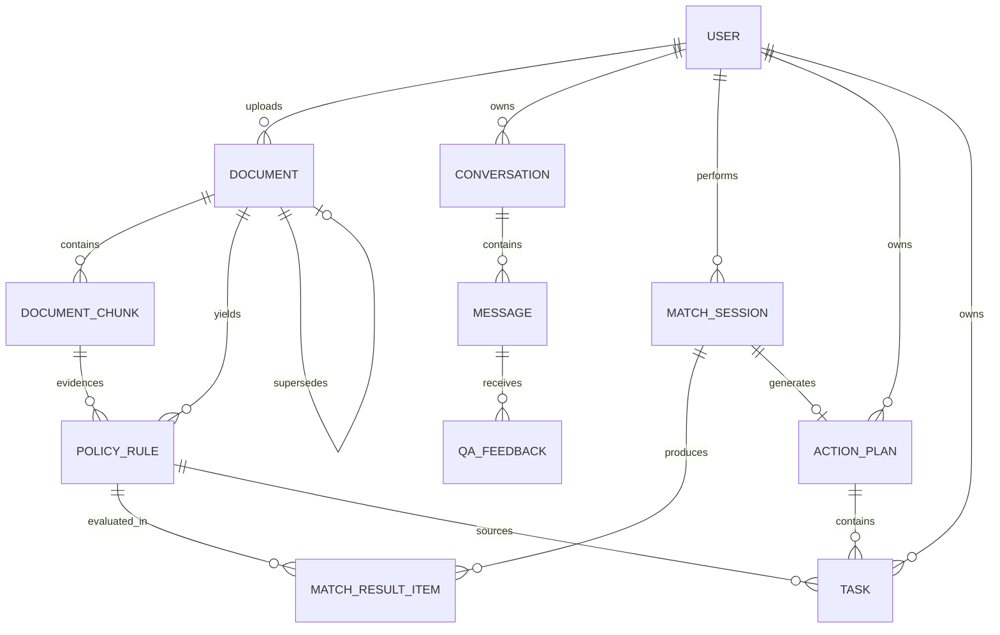

# 数据模型设计

> 项目：知校 · 校园政策智能理解与事务规划系统
> 文档版本：V1.0
> 编制日期：2026-11-07
> 对应里程碑：M1（设计冻结）→ M2（建表）
> 实现载体：SQLAlchemy 2.0 声明式模型（`app/models.py`）+ `tools/init_db.py` 建表脚本

---

## 修订记录

| 版本 | 日期 | 修订内容 |
| --- | --- | --- |
| V1.0 | 2026-11-07 | 首版：12 张表、枚举、索引、状态机、SQLite 落地约定 |

---

## 1. 设计约定

| 项 | 约定 | 理由 |
| --- | --- | --- |
| 主键 | 统一 `id VARCHAR(26)`，ULID | 时间有序、可跨库迁移、前端不可预测 |
| 时间 | 统一 `DATETIME`，**存 UTC**，前端按本地时区渲染 | 避免时区歧义；SQLite 无原生时区类型 |
| 布尔 | `INTEGER 0/1` + ORM `Boolean` | SQLite 无 BOOLEAN |
| JSON | `TEXT` 存 JSON 字符串（SQLite 有 `JSON1` 但不做列约束） | 兼容 PostgreSQL `JSONB` 迁移 |
| 向量 | `BLOB` 存 `float32` 小端字节 | 无需向量库；`numpy.frombuffer` 还原 |
| 软删除 | 仅 `documents` 使用 `deleted_at` | 文档删除需保留引用可追溯 |
| 命名 | 表名复数蛇形；字段蛇形；外键 `<表名单数>_id` | 与既有项目一致 |
| 枚举 | 存 `VARCHAR` 字面值，**不存整型** | 直读数据库可懂；校验在应用层 |
| 迁移 | M1–M5 用 `tools/init_db.py` 建表；M6 起如需变更再引入 Alembic | 11 天内不做无收益的迁移基建 |

---

## 2. ER 关系



**四条不可违反的完整性约束**（写入校验 + 测试用例）：

1. `document_chunks.document_id` 必须存在，删文档级联删片段；
2. `policy_rules.chunk_id` **非空**——规则必须有证据，无证据的规则不允许入库；
3. `tasks.source_rule_id` 可为空（手工任务），但若不为空必须指向存在的规则；
4. `action_plans.status='draft'` 时，其任务不允许出现在 `/tasks` 列表（查询强制 `plan.status='confirmed'`）。

---

## 3. 表结构

### 3.1 users

| 字段 | 类型 | 约束 | 说明 |
| --- | --- | --- | --- |
| id | VARCHAR(26) | PK | ULID |
| username | VARCHAR(64) | UNIQUE NOT NULL | 登录名 |
| display_name | VARCHAR(64) | NOT NULL | 显示名 |
| password_hash | VARCHAR(128) | NOT NULL | `werkzeug.security` 或 bcrypt |
| role | VARCHAR(16) | NOT NULL CHECK IN ('student','admin') | |
| created_at | DATETIME | NOT NULL | |

索引：`uq_users_username`

**种子数据**（`tools/seed_demo.py`，全部虚构）：`student/student123`（role=student）、`admin/admin123`（role=admin）。

### 3.2 documents

| 字段 | 类型 | 约束 | 说明 |
| --- | --- | --- | --- |
| id | VARCHAR(26) | PK | |
| title | VARCHAR(200) | NOT NULL | 可编辑标题 |
| file_name | VARCHAR(255) | NOT NULL | 原始文件名（仅展示） |
| stored_name | VARCHAR(64) | NOT NULL UNIQUE | 落盘名 = `{ulid}.{ext}` |
| file_type | VARCHAR(16) | NOT NULL | pdf/docx/txt/md |
| file_size | INTEGER | NOT NULL | 字节 |
| file_hash | VARCHAR(64) | | SHA-256，重复检测 |
| department | VARCHAR(100) | NULL | 发布部门 |
| published_at | DATE | NULL | 未知留空，**不填假日期** |
| academic_year | VARCHAR(16) | NULL | 如 `2026-2027` |
| version_label | VARCHAR(32) | NULL | 如 `V3` |
| effective_status | VARCHAR(16) | NOT NULL DEFAULT 'unknown' | active/superseded/expired/unknown |
| supersedes_id | VARCHAR(26) | NULL FK→documents.id | 替代了哪份 |
| scope_note | VARCHAR(200) | NULL | 适用范围备注 |
| parse_status | VARCHAR(16) | NOT NULL DEFAULT 'uploaded' | 见 §4.1 |
| parse_error | TEXT | NULL | 失败原因（人类可读） |
| chunk_count | INTEGER | NOT NULL DEFAULT 0 | |
| uploader_id | VARCHAR(26) | NOT NULL FK→users.id | |
| created_at | DATETIME | NOT NULL | |
| updated_at | DATETIME | NOT NULL | |
| deleted_at | DATETIME | NULL | 软删除 |

索引：`idx_documents_parse_status`、`idx_documents_effective_status`、`idx_documents_hash`、`idx_documents_academic_year`

### 3.3 document_chunks

| 字段 | 类型 | 约束 | 说明 |
| --- | --- | --- | --- |
| id | VARCHAR(26) | PK | |
| document_id | VARCHAR(26) | NOT NULL FK→documents.id ON DELETE CASCADE | |
| chunk_index | INTEGER | NOT NULL | 文档内顺序，从 0 起 |
| content | TEXT | NOT NULL | 片段正文 |
| char_start | INTEGER | NOT NULL | 原文起始偏移 |
| char_end | INTEGER | NOT NULL | 原文结束偏移 |
| page_number | INTEGER | NULL | PDF 页码；DOCX 可为空 |
| section_title | VARCHAR(200) | NULL | 所属章节标题 |
| token_count | INTEGER | NULL | 粗估（中文按字符/1.5） |
| embedding | BLOB | NULL | float32 小端；维度随模型 |
| embedding_model | VARCHAR(64) | NULL | 换模型后可识别需重建 |
| created_at | DATETIME | NOT NULL | |

索引：`uq_chunks_doc_index(document_id, chunk_index)`、`idx_chunks_document`

### 3.4 conversations

| 字段 | 类型 | 约束 | 说明 |
| --- | --- | --- | --- |
| id | VARCHAR(26) | PK | |
| user_id | VARCHAR(26) | NOT NULL FK | |
| title | VARCHAR(120) | NULL | 取首问前 30 字 |
| created_at | DATETIME | NOT NULL | |

索引：`idx_conv_user_created(user_id, created_at DESC)`

### 3.5 messages

| 字段 | 类型 | 约束 | 说明 |
| --- | --- | --- | --- |
| id | VARCHAR(26) | PK | |
| conversation_id | VARCHAR(26) | NOT NULL FK | |
| role | VARCHAR(12) | NOT NULL CHECK IN ('user','assistant') | |
| content | TEXT | NOT NULL | 用户原文 / 助手纯文本 |
| answer_json | TEXT | NULL | **校验后**的结构化答案（非原始模型输出） |
| citations_json | TEXT | NULL | 引用快照（含 chunk_id/page/quote） |
| workflow_run_id | VARCHAR(26) | NULL FK→workflow_runs.id | |
| model_name | VARCHAR(64) | NULL | |
| latency_ms | INTEGER | NULL | |
| mode | VARCHAR(16) | NULL | llm / retrieval_only / degraded |
| created_at | DATETIME | NOT NULL | |

索引：`idx_msg_conv_created(conversation_id, created_at)`

### 3.6 policy_rules

| 字段 | 类型 | 约束 | 说明 |
| --- | --- | --- | --- |
| id | VARCHAR(26) | PK | |
| document_id | VARCHAR(26) | NOT NULL FK | |
| chunk_id | VARCHAR(26) | **NOT NULL** FK | 证据必填 |
| rule_code | VARCHAR(32) | NOT NULL | 文档内编号 `R-001` |
| rule_type | VARCHAR(24) | NOT NULL | eligibility/material/deadline/process/restriction |
| description | TEXT | NOT NULL | 中文描述（来自原文或改写） |
| target_group | VARCHAR(64) | NULL | |
| field_key | VARCHAR(64) | NULL | 对应个人信息字段 |
| operator | VARCHAR(20) | NULL | 8 算子之一 |
| expected_value | TEXT | NULL | JSON 编码 |
| required_information | TEXT | NULL | JSON 数组 |
| effective_period | VARCHAR(64) | NULL | 文本描述 |
| page_or_section | VARCHAR(100) | NULL | 展示用定位 |
| original_quote | TEXT | NOT NULL | 原文摘录 ≤200 字 |
| quote_verified | INTEGER | NOT NULL DEFAULT 0 | 是否通过"原文子串"校验 |
| extraction_status | VARCHAR(16) | NOT NULL DEFAULT 'suggested' | suggested/verified/rejected |
| review_status | VARCHAR(16) | NOT NULL DEFAULT 'needs_review' | auto/needs_review/confirmed |
| confidence | VARCHAR(12) | NULL | high/medium/low |
| schema_version | VARCHAR(8) | NOT NULL DEFAULT 'v1' | |
| created_at | DATETIME | NOT NULL | |

索引：`idx_rules_document`、`idx_rules_chunk`、`idx_rules_review(review_status)`

> `quote_verified=0` 的规则**不得参与正式匹配**，这是防伪造出处的主要开关。

### 3.7 match_sessions

| 字段 | 类型 | 约束 | 说明 |
| --- | --- | --- | --- |
| id | VARCHAR(26) | PK | |
| user_id | VARCHAR(26) | NOT NULL FK | |
| document_id | VARCHAR(26) | NOT NULL FK | |
| profile_json | TEXT | NOT NULL | 用户填写的条件（最少必要） |
| rule_snapshot_json | TEXT | NOT NULL | **匹配时的规则快照** |
| sum_met | INTEGER | NOT NULL DEFAULT 0 | |
| sum_not_met | INTEGER | NOT NULL DEFAULT 0 | |
| sum_unknown | INTEGER | NOT NULL DEFAULT 0 | |
| created_at | DATETIME | NOT NULL | |

> 为什么要快照：规则后续可能被管理员修正，若不留快照，历史匹配结果无法解释"当时为什么这么判"。

### 3.8 match_result_items

| 字段 | 类型 | 约束 | 说明 |
| --- | --- | --- | --- |
| id | VARCHAR(26) | PK | |
| session_id | VARCHAR(26) | NOT NULL FK | |
| rule_id | VARCHAR(26) | NOT NULL FK | |
| status | VARCHAR(12) | NOT NULL | met/not_met/unknown |
| unknown_reason | VARCHAR(24) | NULL | missing_info/ambiguous_rule/no_evidence/conflicting_policy |
| user_value | VARCHAR(200) | NULL | |
| expected_value | VARCHAR(200) | NULL | |
| rationale | TEXT | NULL | 判定理由（人类可读） |
| evidence_chunk_id | VARCHAR(26) | NULL FK | |
| created_at | DATETIME | NOT NULL | |

索引：`idx_mri_session(session_id)`、`idx_mri_status(status)`

### 3.9 action_plans

| 字段 | 类型 | 约束 | 说明 |
| --- | --- | --- | --- |
| id | VARCHAR(26) | PK | |
| user_id | VARCHAR(26) | NOT NULL FK | |
| document_id | VARCHAR(26) | NOT NULL FK | |
| match_session_id | VARCHAR(26) | NULL FK | 可手工建计划 |
| title | VARCHAR(200) | NOT NULL | |
| status | VARCHAR(16) | NOT NULL DEFAULT 'draft' | draft/confirmed/archived/rejected |
| created_at | DATETIME | NOT NULL | |
| confirmed_at | DATETIME | NULL | |

索引：`idx_plan_user_status(user_id, status)`

### 3.10 tasks

| 字段 | 类型 | 约束 | 说明 |
| --- | --- | --- | --- |
| id | VARCHAR(26) | PK | |
| plan_id | VARCHAR(26) | NOT NULL FK | |
| user_id | VARCHAR(26) | NOT NULL FK | 冗余，便于按用户直查 |
| title | VARCHAR(200) | NOT NULL | |
| description | TEXT | NULL | |
| required_materials | TEXT | NULL | JSON 数组 |
| due_at | DATETIME | **NULL 允许** | 无来源即空，禁止编造 |
| due_source | VARCHAR(12) | NULL | rule/document/manual |
| priority | VARCHAR(4) | NOT NULL DEFAULT 'P2' | P0–P3 |
| status | VARCHAR(12) | NOT NULL DEFAULT 'todo' | todo/doing/done/deferred/cancelled |
| source_document_id | VARCHAR(26) | NULL FK | |
| source_rule_id | VARCHAR(26) | NULL FK | |
| needs_human_confirmation | INTEGER | NOT NULL DEFAULT 0 | |
| dependency_ids | TEXT | NULL | JSON 数组 |
| sort_order | INTEGER | NOT NULL DEFAULT 0 | |
| created_at / updated_at | DATETIME | NOT NULL | |
| completed_at | DATETIME | NULL | |

索引：`idx_task_user_status(user_id, status)`、`idx_task_due(due_at)`、`idx_task_plan(plan_id)`

### 3.11 workflow_runs

| 字段 | 类型 | 约束 | 说明 |
| --- | --- | --- | --- |
| id | VARCHAR(26) | PK | |
| user_id | VARCHAR(26) | NOT NULL FK | |
| run_type | VARCHAR(16) | NOT NULL | qa/match/plan |
| status | VARCHAR(16) | NOT NULL | running/succeeded/failed/degraded |
| node_traces_json | TEXT | NULL | 六节点 `{name,status,ms,summary}` |
| total_ms | INTEGER | NULL | |
| model_calls | INTEGER | NOT NULL DEFAULT 0 | |
| error | TEXT | NULL | |
| created_at | DATETIME | NOT NULL | |

> 前端节点轨迹**只读这张表**。无 `node_traces_json` 就不渲染轨迹条——这是"不造假进度条"的技术保证。

### 3.12 qa_feedback / 3.13 audit_logs

| 表 | 字段 | 说明 |
| --- | --- | --- |
| qa_feedback | id, message_id, user_id, helpful(INT), reason_code, comment, created_at | reason_code：`wrong_citation`/`incomplete`/`irrelevant`/`too_vague`/`other` |
| audit_logs | id, user_id, action, resource_type, resource_id, detail_json, request_id, created_at | action 例：`document.delete`/`plan.confirm`/`task.status` |

索引：`idx_feedback_message`、`idx_audit_created`

---

## 4. 枚举与状态机

### 4.1 documents.parse_status

| 状态 | 含义 | 允许转移 |
| --- | --- | --- |
| uploaded | 已落盘、已登记 | → parsing |
| parsing | 解析中 | → parsed / empty / failed |
| parsed | 文本提取成功 | → chunked |
| chunked | 切分完成 | → indexed |
| indexed | 索引与向量就绪（终态） | → parsing（管理员重建） |
| empty | 有效文本 < 50 字 | → parsing（重传/OCR 后） |
| failed | 加密/损坏/异常 | → parsing（修复后） |

### 4.2 其他枚举

| 字段 | 取值 |
| --- | --- |
| documents.effective_status | `active` / `superseded` / `expired` / `unknown` |
| policy_rules.rule_type | `eligibility` / `material` / `deadline` / `process` / `restriction` |
| policy_rules.operator | `equals` / `not_equals` / `in` / `gte` / `lte` / `exists` / `contains_any` / `manual_review` |
| match_result_items.status | `met` / `not_met` / `unknown` |
| match_result_items.unknown_reason | `missing_info` / `ambiguous_rule` / `no_evidence` / `conflicting_policy` |
| action_plans.status | `draft` / `confirmed` / `archived` / `rejected` |
| tasks.status | `todo` / `doing` / `done` / `deferred` / `cancelled` |
| tasks.priority | `P0` / `P1` / `P2` / `P3` |
| messages.mode | `llm` / `retrieval_only` / `degraded` |
| workflow_runs.status | `running` / `succeeded` / `failed` / `degraded` |

### 4.3 任务状态转移白名单

| 当前 | 允许目标 |
| --- | --- |
| todo | doing / done / deferred / cancelled |
| doing | done / deferred / cancelled |
| deferred | todo / cancelled |
| done | todo（撤销） |
| cancelled | —（终态） |

非法转移统一返回 `409 / 2005 STATE_TRANSITION_INVALID`，消息中带当前状态与允许目标。

### 4.4 个人信息字段白名单（`field_key` 取值域）

`student_type`、`grade`、`gpa`、`rank_percent`、`disciplinary_record`、`poverty_certified`、`major`、`credits_earned`、`enrollment_status`。

**不在白名单内的字段名一律拒绝入库**——防止模型编出 `family_income`、`id_card` 这类不该采集的字段。

---

## 5. 索引与规模估算

| 表 | 预估行数（演示） | 预估行数（上限） | 关键索引用途 |
| --- | --- | --- | --- |
| users | 2 | 50 | 登录 |
| documents | 3 | 200 | 列表筛选 |
| document_chunks | ~120 | 20 000 | 检索（全量内存扫描 + BM25 倒排） |
| messages | ~50 | 5 000 | 会话回放 |
| policy_rules | ~30 | 2 000 | 文档详情、复核 |
| match_sessions / items | ~10 / ~70 | 1 000 / 7 000 | 历史查询 |
| tasks | ~10 | 2 000 | 任务中心 |

**检索性能估算**：2 万条 × 768 维 float32 ≈ 61 MB，单次余弦计算约 20ms（numpy 向量化），在 NFR-2 的 800ms 预算内。超过 5 万片段时需引入近似检索——列入已知限制。

---

## 6. SQLite 落地约定

```sql
-- 建库时执行（tools/init_db.py）
PRAGMA journal_mode = WAL;      -- 允许读写并发
PRAGMA synchronous = NORMAL;    -- 性能与安全折中
PRAGMA foreign_keys = ON;       -- 外键必须显式开启
```

| 注意 | 说明 |
| --- | --- |
| 外键 | SQLite 默认不启用，必须在**每个连接**上 `PRAGMA foreign_keys=ON`，否则级联删除静默失效 |
| 并发 | WAL 下仍只有一个写者；演示场景足够，写入加进程内锁 |
| BLOB | `embedding` 用 `numpy.ndarray.astype('<f4').tobytes()`，读回 `np.frombuffer(blob, '<f4')` |
| 时间 | 存 UTC 的 `YYYY-MM-DD HH:MM:SS` 字符串，ORM 侧统一转换 |
| 备份 | `data/app.db` 直接复制即可；演示前先备份一份 |

---

## 7. 与设计说明书的对应

| 设计说明书 | 本文 | 差异说明 |
| --- | --- | --- |
| §5.1 ER 图 | §2 | 一致 |
| §5.2 表结构 | §3 | 本文补 `stored_name`、`quote_verified`、`due_source`、`model_name`、`mode` 五个实现必需字段 |
| §5.3 状态枚举 | §4 | 一致，补 `parse_status` 完整转移表 |
| §5.4 数据最小化 | §4.4 | 增补 `field_key` 白名单机制 |

> 若实现中发现需要增减字段，**先改本文并记录，再改模型**。禁止直接在 `models.py` 里加字段而不更新文档。
